<div align="center">
  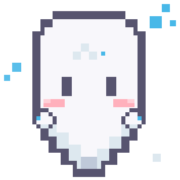
  <h1>NOIRADIX Studio</h1>
  <p><strong>High-Performance, AI-Native Pixel Art & Spritesheet Studio for the <code>.pix2</code> Standard</strong></p>

  <p>
    <a href="https://noiradix.me/"></a>
    <a href="https://noiradix.me/pixelart/"></a>
    <a href="https://github.com/dotlinux26/noiradix-studio/actions/workflows/deploy.yml"></a>
    <a href="LICENSE"></a>
    <a href="PIX2_SPECIFICATION.md"></a>
    <a href="https://github.com/dotlinux26/noiradix-studio/releases"></a>
    <a href="PIX2_SPECIFICATION.md"></a>
    <a href="https://github.com/dotlinux26"></a>
    <a href="DONATE.md"></a>
    <a href="CODE_OF_CONDUCT.md"></a>
    <a href="CONTRIBUTING.md"></a>
    <a href="SECURITY.md"></a>
  </p>
</div>

**NOIRADIX Studio** is a pure vanilla, offline-first pixel art editor and animation suite built from the ground up for the `.pix2` semantic text standard. It bridges the gap between AI generation, pixel artists, and modern game engines by providing deterministic sparse-pixel serialization, multi-directional character templates, and game-ready atlas export with anti-bleeding protection.

**Account team:** sign in with ChatGPT and Google, choose account models, and let ChatGPT plan/review while Gemini edits the real Studio canvas. The team shares actual editor feedback and supports one correction pass, permissions, cancellation and usage reporting without API keys. See [account-team setup and limits](docs/ACCOUNT_TEAM.md). Optional API-agent management remains under advanced settings; see [API setup and token audit](docs/AI_MULTI_AGENT.md).

> [!TIP]
> **Looking for standalone 2D pixel painting without animation timelines?**  
> Check out [**NOIRADIX PixelArt**](https://noiradix.me/pixelart/) (`pixelart/index.html`) — our new sibling tool featuring dynamic canvas sizing (16×16 to 512×512), pure 2D illustration tools, a live two-way PIX2 source code editor, and AI prompt studio. See [`docs/PIXELART/`](docs/PIXELART/README.md).

---

## 💡 The Core Philosophy: Why NOIRADIX & `.pix2` Exist

> **"Let machines write the coordinate math. Let humans enjoy the visual canvas."**

### 1. Nobody Wants to Manually Code Pixels by Hand
Let’s be honest: no human artist or game developer is going to sit down and type thousands of coordinate lines like `pixel 4,5 #ffffff` by hand. That would be tedious and impractical.
* **The `.pix2` text format is designed for Machines & AI (LLMs):** It gives language models (Claude, ChatGPT, Gemini) a clean, symbolic grammar to express sprites with symmetry math and geometry algorithms in seconds.
* **NOIRADIX Studio is designed for Humans:** A visual, tactile workbench where you draw with a mouse or tablet, scrub timelines, test walk cycles, and tweak pixels effortlessly.
* **`.pix2` is the Transparent Bridge:** A human-readable and machine-readable intermediate representation that replaces mysterious, proprietary binary blobs with clean, Git-diffable code.

### 2. Logic-Driven Code Over Blurry Diffusion Models
Most generative AI tools rely on heavy diffusion models that hallucinate anti-aliased, blurry pixels, mismatched eye heights, and distorted palettes that cannot be used in real pixel art games.
* With `.pix2`, an LLM doesn't "hallucinate" pixels; it **computes exact discrete coordinates**:
  ```python
  # Exact bilateral mirror symmetry formula
  x_mirror = width - 1 - x
  ```
* The result is **100% deterministic, crisp, integer-grid pixel art** without expensive GPUs or blurry diffusion artifacts.

> [!NOTE]
> **Output Quality Depends on Model Reasoning & Human Retouching:**  
> `.pix2` guarantees integer coordinates and crisp borders, but **it is not a magical artistic oracle**. The aesthetic quality, anatomical proportion, and color harmony generated by AI are **strictly bounded by the reasoning power of the LLM model** you use (e.g. Claude 3.7 Sonnet, GPT-4o, Gemini 2.5 Pro vs. compact lightweight models).  
> Raw AI generation serves as **rapid structural scaffolding and timing draft in seconds**. Turning AI-generated scaffolding into game-ready art **still requires human eyes and artist touch** — fine-tuning palettes, adjusting facial expressions, and adding nuanced pixel details inside NOIRADIX Studio.

### 3. Exclusively Focused on 2D Pixel Art
NOIRADIX Studio does not attempt to be a bloated 1,000-menu painting suite like Photoshop or Aseprite, nor does it dabble in 3D meshes or vector graphics. It is razor-focused on one painful bottleneck:  
👉 **Taking you from an idea or sprite sheet to a fully working, directional walking character inside Unity 2D in 1 click — saving 15 to 20 minutes of tedious manual slicing and animator wiring per character.**

### 4. Clear Boundary: Native Import & Slice vs. Vector Autotracing
A common architectural boundary in NOIRADIX is the distinction between raster slicing and vector autotracing:
* **NOIRADIX does not perform heuristic vector autotracing.** We reject error-prone image-to-vector curve fitting algorithms that smear sharp pixel clusters into distorted Bézier shapes.
* **Native Import & Slice Pipeline (Studio 2.0):** Instead, NOIRADIX Studio 2.0 includes a dedicated, mathematically exact **Import & Slice Pipeline** for raster images (`.png`, `.jpg`, `.webp`) and atlas metadata (`TexturePacker` JSON Hash/Array, `Aseprite` JSON, Uniform Grid):
  - **1:1 Discrete Pixel Ingestion:** Slices raster frames directly into discrete `.pix2` cell frames with 100% color fidelity and pure alpha transparency.
  - **Structural Layer Preservation:** Slices can be routed into dedicated structural layers (`@layer`) and named regions (`@region`).
  - **Automated Clip Assembly:** Parses atlas animation sequences, frame tags, and frame rates directly into working playback clips without manual re-linking.
  - **Import Code (<kbd>Ctrl</kbd> + <kbd>I</kbd>):** Dedicated instant modal for pasting raw `.pix2` DSL code generated by AI assistants (Claude, ChatGPT, Gemini).

---

## 💎 The Strategic Edge: "Sprite as Structured Data" (SaaD)

Traditional tools treat sprites as opaque raster bitmaps (PNGs). NOIRADIX establishes an entirely different paradigm: **Sprite as Structured Data**.  
We do not attempt to out-compete monolithic 1,000-feature drawing apps on brush plugins. Instead, we solve how 2D game artwork is **represented, programmatically manipulated, versioned, and repurposed**:

```
[ Human Artists ] ── (Visual Touch & Polish) ──┐
                                               ▼
[ AI Models ]    ── (Coordinate Logic)   ──► [ .pix2 DSL ] ──► [ Game Engines (Unity / Godot) ]
                                            (Structured Data)   (1-Click Native Clips & Atlas)
```

### The 5 Architectural Pillars of `.pix2`:

1. **Deterministic Rendering:**  
   The same `.pix2` document and specification version will produce the exact same pixel matrix across every machine and renderer. Regenerating or tweaking code never introduces random pixel mutations, eye shifts, or blurred outlines.
2. **Data-Level Editability:**  
   Artwork can be modified programmatically at the coordinate, palette, or cell layer. Instead of repainting 32 individual frames by hand, software agents or scripts can re-index palette IDs, adjust symmetry axes, or swap weapon attachments with mathematical precision.
3. **Modular Reusability:**  
   A base character skeleton can effortlessly generate dozens of equipment overlays, armor variations, or directional walk cycles without redrawing the baseline artwork from scratch.
4. **Ecosystem Interoperability:**  
   Because `.pix2` is an open, human-readable specification, any toolchain, pipeline script, or game engine in Python, C#, Rust, or JavaScript can easily build custom parsers, validators, procedural generators, and automated CI importers.
5. **Git-Native Versionability:**  
   Sprites cease to be opaque binary blobs polluting Git repositories and Git LFS. Every single visual change is a clean text diff that can be reviewed in GitHub Pull Requests, branched, merged, and safely rolled back.

> [!TIP]
> **Beyond 2D Sprites: Researching Coordinate-Aware High-Resolution Editing**  
> Wondering how structured coordinates could apply to Full HD or 2K raster workflows without bloating into millions of text lines? Read our non-normative research proposal:  
> 📄 **[PIX2 Future Directions: Coordinate-Aware Raster Editing](docs/PIX2/PIX2_FUTURE_DIRECTIONS.md)** — exploring ROI selection, localized PIX2 Patch application, and deterministic image modification.

---

## 📸 Studio Visual Tour

Experience desktop-grade pixel art creation directly in your browser with zero installation:

### 🌟 60-Second Full Walkthrough (From AI Prompt to Unity 2D)

https://github.com/user-attachments/assets/5098357c-daa5-44da-90a8-a1fc23f0c42f

*Comprehensive 60-second video walkthrough: Authoring sprites in NOIRADIX Studio, dynamic AI prompt generation, real-time directional animation playback, and 1-click Unity 2D package export.*

---

### 🚀 Live Workflow Preview: Browser to Unity 2D in 1 Click
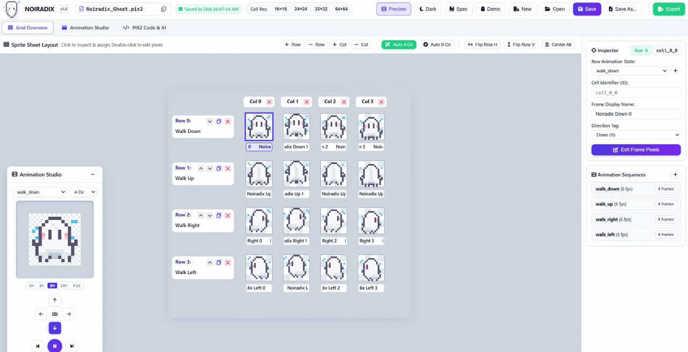
*Real-time demonstration of authoring sprite animations in NOIRADIX Studio, exporting the game package, and 1-click importing directly into Unity 6.*

---

### 1. Sprite Sheet Matrix & Multi-Frame Layout
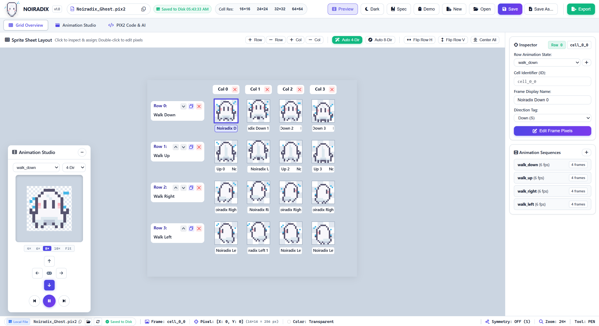
*Multi-cell matrix with row-level animation states, column frame sequences, cell resolution presets (16×16 to 64×64), and interactive Inspector panel.*

---

### 2. Directional Animation Studio (Real-Time Playback)
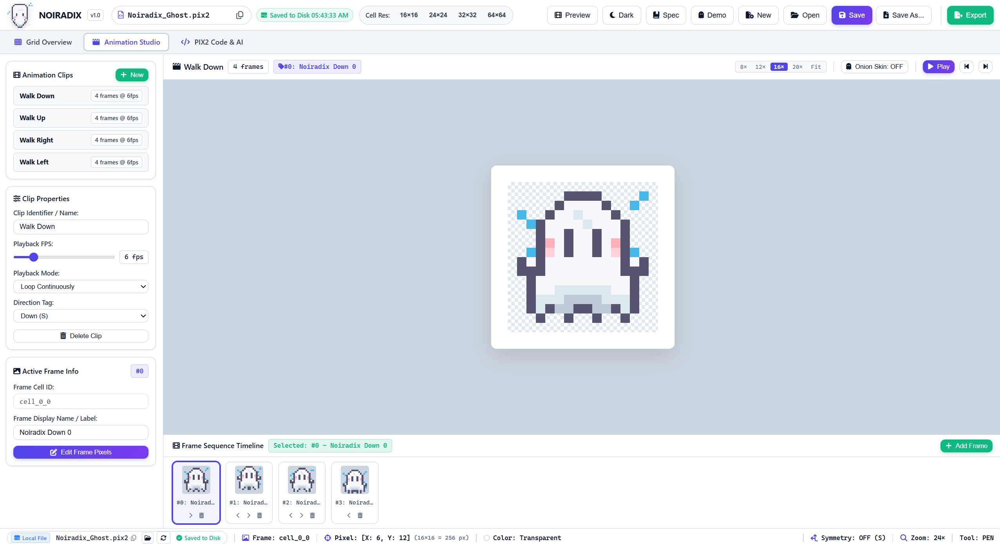
*Floating real-time playback player supporting 4-direction and 8-direction compass previews, variable FPS slider, and loop controls.*

---

### 3. Precision Pixel Editor with Rulers & Symmetry
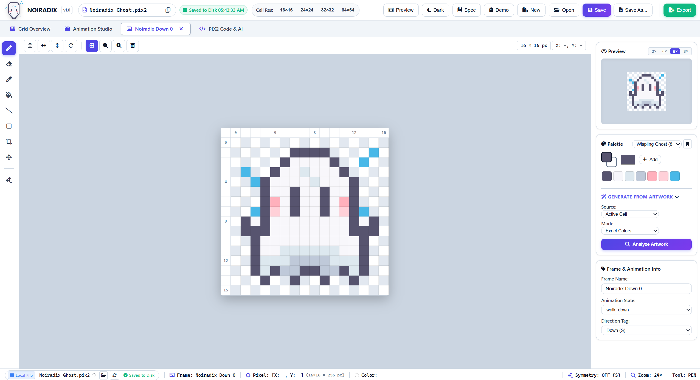
*Bilateral symmetry mirror axis (`sym_dot`), 4× to 64× anchor-centered zoom, dynamic pixel rulers, discrete drawing tools, and palette swatches.*

---

### 4. AI-Native PIX2 Code & 1-Click Prompt Studio
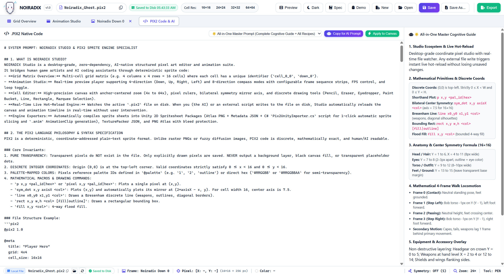
*1-Click "Copy Prompt for AI", token-efficient sparse `.pix2` syntax, zero-hallucination coordinates, live syntax highlighting with swatch preview, safe View-Only mode, and real-time disk hot-reload.*

---

## 🚀 Quick Start Guide (5 Minutes)

Get up and running immediately with zero configuration and zero build tools:

### Step 1: Launch NOIRADIX Studio
* **Instant Online Studio (Zero Install):** Open [**https://noiradix.me/**](https://noiradix.me/) directly in your browser.
* **macOS / Windows (1-Click Local):** Double-click [`start-noiradix-studio.command`](start-noiradix-studio.command) on macOS or [`start-noiradix-studio.bat`](start-noiradix-studio.bat) on Windows. It starts localhost and opens your browser. Source checkouts require Node.js 22+; portable ZIP releases include it.
* **Share with someone who does not code:** Build the two portable ZIPs with `node tools/package-studio.mjs`. Send the matching ZIP from `dist/`. The recipient extracts it and double-clicks **Mo Studio.command** (macOS) or **Mo Studio.bat** (Windows), with no Node.js installation or terminal commands. See [portable release instructions](docs/LOCALHOST.md) and the recipient's [BẮT ĐẦU guide](BAT-DAU.txt).
* **Direct File:** Simply open [`index.html`](index.html) in any modern browser (Chrome, Edge, Brave, Opera, Arc).
* **Local Studio Server (Optional, Node.js 22+):**
  ```bash
  node tools/launch-studio.mjs
  ```
  Open `http://127.0.0.1:8080/`. In **Trợ lý AI**, ask AI to manage frames, animations, FPS and layers, transform or draw artwork, import reference images and prepare downloadable PNG/ZIP/PIX2 files. Use **Continue with ChatGPT** to sign in and authorize eligible plan usage, or configure a separate API key; see [AI Chat setup](docs/AI_CHAT.md).

---

### Step 2: Create, Open, or Import a Sprite Project
* **Create a New Project:** Press <kbd>Ctrl</kbd> + <kbd>N</kbd> or click the **New** button in the top navigation bar. Enter your file name (e.g. `hero_knight.pix2`) and select a layout preset:
  * **4-Direction Walk:** 4 rows × 4 columns (16 frames) — *Down, Up, Right, Left*.
  * **8-Direction Combat:** 8 rows × 4 columns (32 frames) — *Full compass locomotion*.
  * **Action Strip:** 1 row × 6 columns — *Single animation sequence (dash, slash, jump)*.
  * **Single Frame:** 1 row × 1 column — *Static item, icon, tile, or portrait*.
* **Import PIX2 Code (<kbd>Ctrl</kbd> + <kbd>I</kbd>):** Click the **Import** button (<i class="fa-solid fa-file-import"></i>) in the top navigation bar to paste `.pix2` DSL code directly generated by AI assistants (Gemini, Claude, ChatGPT) and load it instantly into the Studio. *(Note: NOIRADIX does not auto-convert raster PNG/JPG files into `.pix2`; the Import tool is strictly for `.pix2` text code and project files).*
* **Open an Existing Project:** Drag and drop any `.pix2` file onto the window, or click **Open** (<kbd>Ctrl</kbd> + <kbd>O</kbd>).

---

### Step 3: Draw in the Precision Cell Editor
1. In the **Sprite Sheet Layout**, double-click any frame (or click **Edit Frame Pixels**).
2. The Studio opens the **Cell Editor** with high-precision tools:
   * **Pencil (<kbd>B</kbd>):** Discrete pixel placement.
   * **Bilateral Symmetry Axis (<kbd>S</kbd>):** Draw bilateral symmetrical characters automatically (`sym_dot` formula).
   * **Dynamic Pixel Rulers:** Live X/Y rulers update as you zoom (<kbd>Ctrl</kbd> + Mouse Wheel, `4×` to `64×`) and pan (<kbd>Space</kbd> + Drag or <kbd>H</kbd>).
   * **Eyedropper (<kbd>I</kbd>) & Palette Swatches:** Pick colors from the canvas or click any swatch in the bottom palette.
   * **Line (<kbd>L</kbd>), Rectangle (<kbd>U</kbd>), Paint Bucket (<kbd>G</kbd>), Eraser (<kbd>E</kbd>).**

---

### Step 4: Preview Real-Time Animations
1. Click the **Preview** button in the top bar or press <kbd>Space</kbd> while on the grid to toggle the **Animation Studio** floating panel.
2. Select your compass direction (`Down`, `Up`, `Right`, `Left`, etc.).
3. Drag the **FPS Slider** to adjust playback speed (1 to 30 FPS).
4. Watch character walk cycles update live as you paint!

---

### Step 5: Supercharge with AI Coding Assistants
NOIRADIX Studio is designed from day one to pair-program with AI (ChatGPT, Claude, Gemini, Antigravity, Cursor):
1. Click the **AI** / **Spec** button in the top navigation bar.
2. Click **"Copy Prompt for AI"** — this generates a structured system prompt containing the exact mathematical coordinate rules, color palette, and current character state.
3. Paste the prompt into your AI coding assistant and ask it to design characters, synthesize walk cycles, or generate equipment overlays.
4. Save the generated `.pix2` code to disk — NOIRADIX Studio's **Real-Time Live Watcher** automatically reloads the canvas and animation timeline instantly!

---

### Step 6: Save to Disk & Memory Draft Protection
* **Direct Disk Save (<kbd>Ctrl</kbd> + <kbd>S</kbd>):** In Chromium browsers (Chrome, Edge, Brave), NOIRADIX Studio writes directly to your local `.pix2` file using the File System Access API without disruptive download prompts.
* **In-Memory Draft Safety:** When working on an unsaved new file, the statusbar displays an amber badge (`⚠️ In-Memory Draft`). Your work is cached safely in memory so refreshing the page (<kbd>F5</kbd>) will never lose your unsaved edits.
* **Project Base Directory:** Click the **Folder icon** in the statusbar to set your game project root (e.g. `D:/MyGame/Assets`). The **Copy Path** button will then copy full, absolute filesystem paths directly to your clipboard.

---

### Step 7: Export to Your Game Engine
1. Click **Export** in the top navigation bar.
2. Choose your game engine target:
   * **Unity 2D Spritesheet Package (.ZIP):** Atlas PNG + JSON Metadata + C# `Pix2UnityImporter.cs` + `README_UNITY_IMPORT.txt` for 1-click automatic sprite slicing and `.anim` AnimationClip generation.
   * **TexturePacker JSON (.ZIP):** Universal Hash format ready for Godot 4, Phaser, Pixi.js, Defold, Raylib, and GameMaker.
   * **PNG Spritesheet Only:** High-res transparent atlas with configurable Cell Spacing (`0px`–`4px`) and Extrude Edge Pixels to eliminate GPU bleeding seams.
   * **Individual Sliced Frames (.ZIP):** Numbered transparent PNGs.

---

## 🎮 Unity 2D Engine Integration Walkthrough

NOIRADIX Studio delivers a seamless, zero-friction bridge into Unity 2D:

### Step 1: Configure & Export Unity 2D Package (.ZIP)
In NOIRADIX Studio, click **Export** in the top navigation bar. Select **Unity 2D Sprite Package** and configure your anti-bleed spacing (recommended: `1px Bleed Guard` with `Extrude Edge Pixels` checked). Click **Export Unity 2D Package (.ZIP)**.

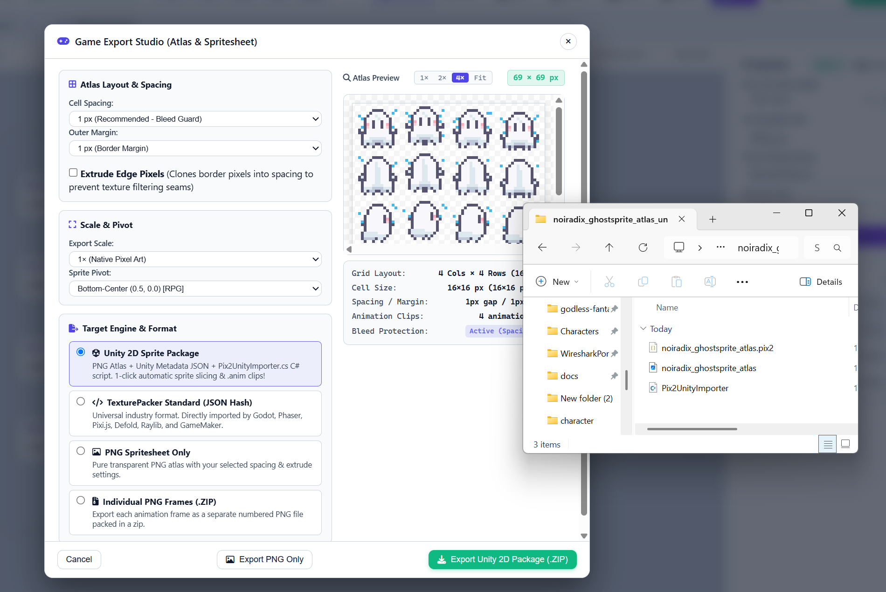
*Configuring sprite sheet padding, extrude edge guards, and Unity metadata in NOIRADIX Studio.*

---

### Step 2: Download & Inspect the Unity Package (.ZIP)
Open the downloaded `{project}_unity_package.zip` archive. It contains the sprite atlas PNG, `.pix2.json` metadata, `Pix2UnityImporter.cs`, and `README_UNITY_IMPORT.txt`.

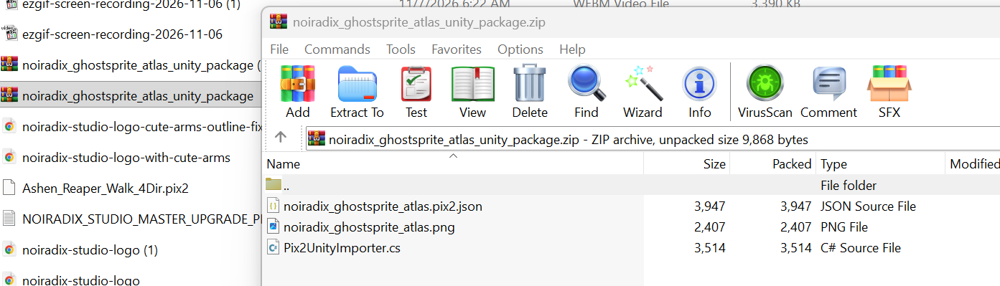
*Package contents: atlas texture, metadata JSON, 1-click C# importer script, and instruction guide.*

---

### Step 3: Drag Sprites & Metadata into Unity
Drag the sprite atlas PNG and `.pix2.json` metadata file directly into your Unity project directory (e.g. `Assets/_Game/Art/Sprites/Noiradix/`). Make sure `Pix2UnityImporter.cs` is inside your project's `Editor/` folder (`Assets/_Game/Editor/`).

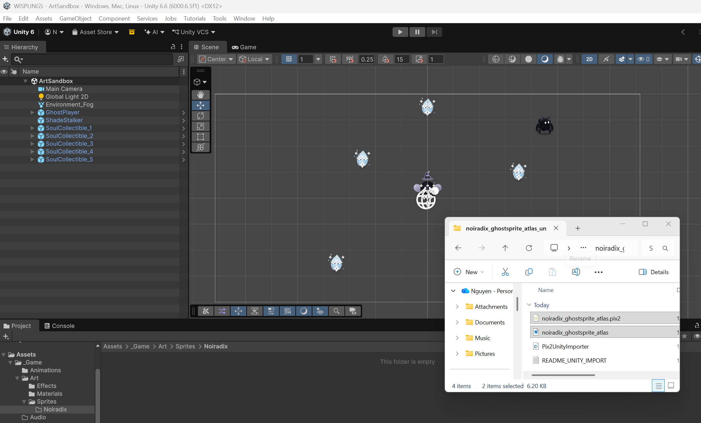
*Dragging the exported atlas and JSON metadata from File Explorer into Unity's Project tab.*

---

### Step 4: Files Placed in Unity Project Tab
Both the transparent atlas PNG and `.pix2.json` metadata files appear in your designated sprite directory:

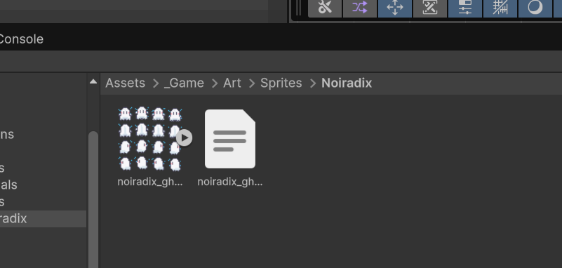
*Prismatic sprite atlas and JSON metadata ready for 1-click automatic processing.*

---

### Step 5: 1-Click Right-Click Context Menu Import
In your Unity Project window, **RIGHT-CLICK** the `.pix2.json` file and select:  
👉 **NOIRADIX > Import Spritesheet & Animations**  
*(Or use the top menu bar: `Tools > NOIRADIX > Import Pix2 Spritesheet JSON...`)*.

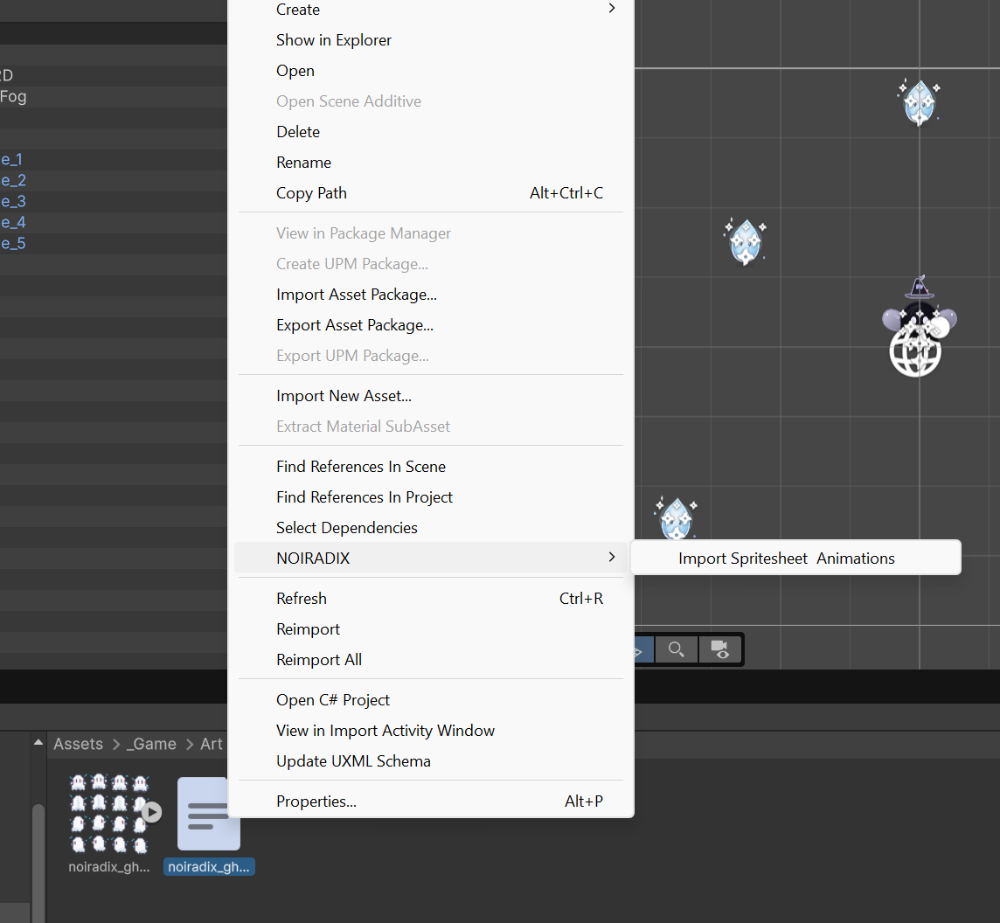
*Executing the 1-click automated asset processing pipeline.*

---

### Step 6: Import Complete Confirmation
An import summary dialog confirms that all 16 frames were sliced and 4 native `.anim` Animation Clips were generated:

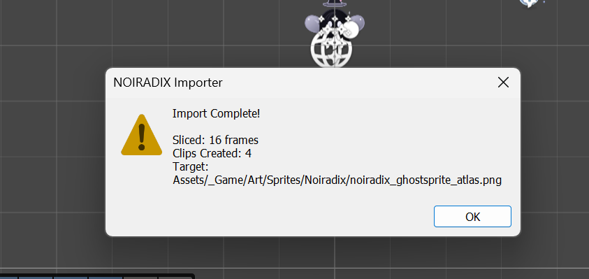
*Confirmation dialog displaying sliced frame count, animation clips generated, and target file path.*

---

### Step 7: Automatic `Animations/` Folder Creation
The importer automatically creates an `Animations/` subfolder right beside your sprite containing all 4 directional Animation Clips:

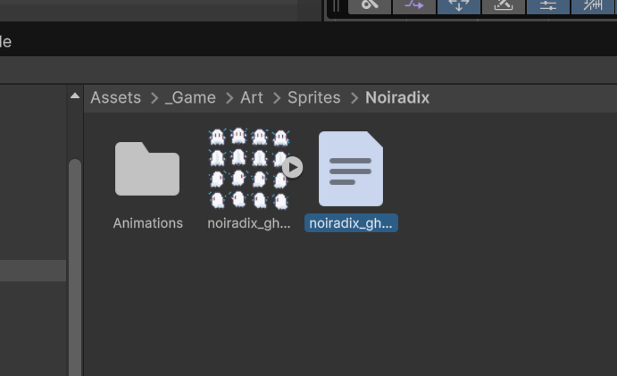
*The `Animations` directory is automatically generated containing `walk_down`, `walk_left`, `walk_right`, and `walk_up`.*

---

### Step 8: Native Animation Timeline & Keyframe Verification
Open the native Unity Animation window on `walk_down` to see all 4 keyframes pre-wired with 6 FPS timing, loop settings, and sprite curve bindings:

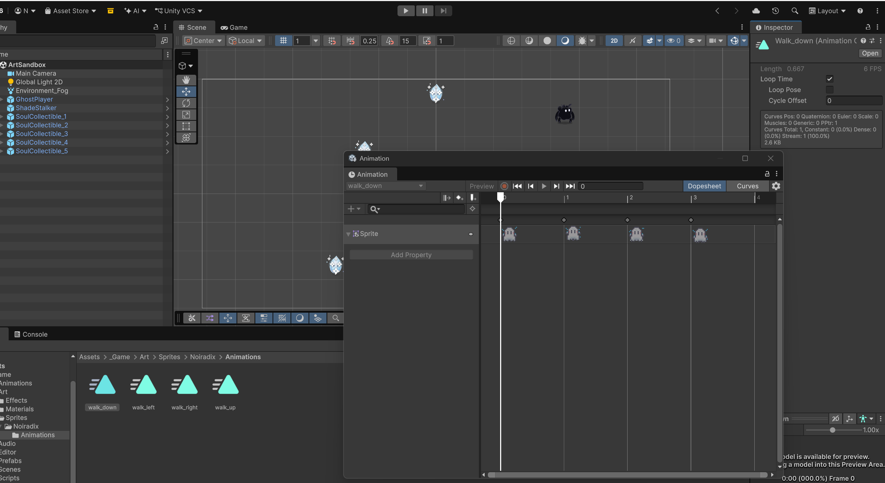
*Native Unity Animation Dopesheet timeline with 4 keyframes bound to SpriteRenderer.m_Sprite.*

---

### Step 9: Sliced Sub-Sprites & Dragging into Scene
Click the expand arrow next to the sprite atlas to view all 16 sliced sub-sprites (`Noiradix Down 0`, `Noiradix Down 1`, etc.). Drag `Noiradix Down 0` directly into your Scene:

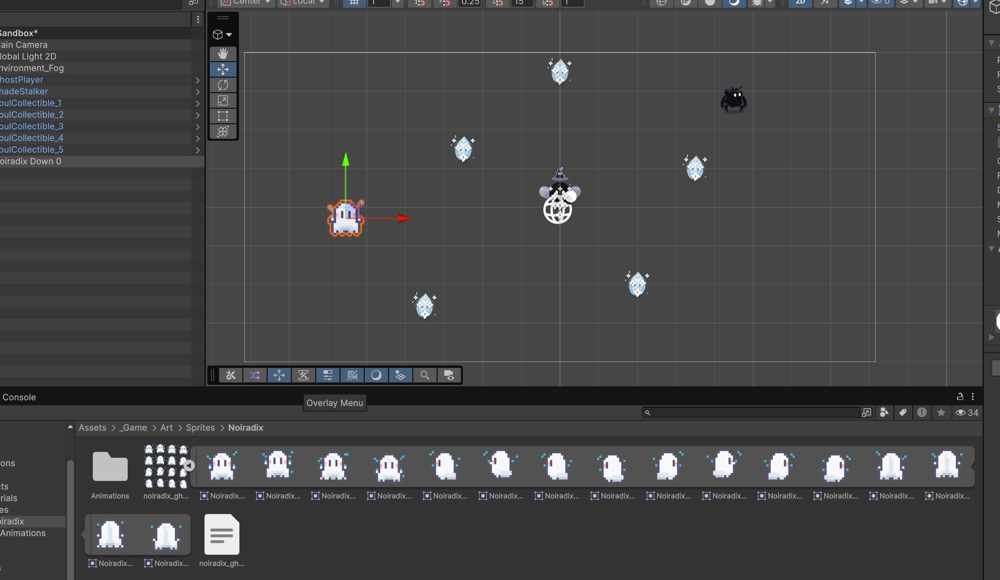
*All 16 sliced sub-sprites visible in the Project tab and placed directly into the Scene viewport.*

---

### Step 10: Live Animator Controller & Scene Setup
Attach the animation clip to the sprite to automatically create an Animator Controller component in your scene:

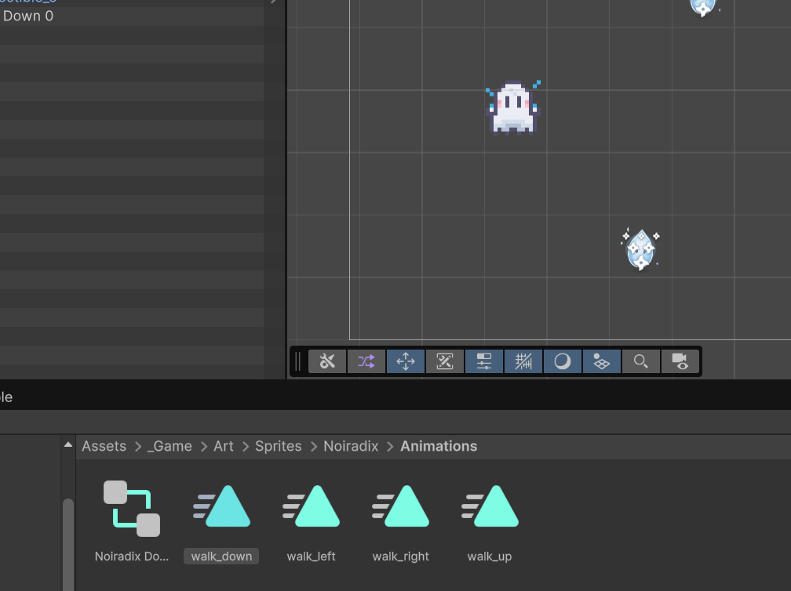
*Character positioned in the scene alongside the generated Animator Controller.*

---

### Step 11: Live Walking Animation in Scene (Real-Time Playback)
Press **Play Game** and watch your character animate with crisp point filtering and zero texture bleeding seams!

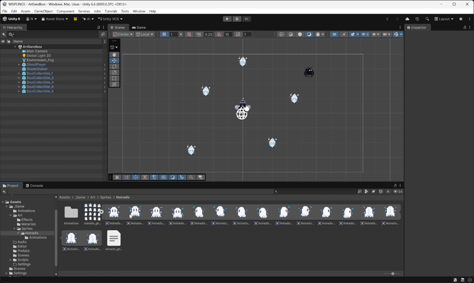
*Real-time animated walk cycle running smoothly inside Unity 6.*

---

## 🌟 Key Highlights

* **100% Pure Vanilla Web Stack:** Zero build tools, zero npm packages, zero runtime frameworks. Runs directly in any modern browser by double-clicking `index.html` or executing `start-noiradix-studio.bat`.
* **AI-Native Sparse Pixel Format (`.pix2`):** Only explicitly drawn pixels are serialized into clean, token-efficient text. Cleanly diffable by Git and LLMs.
* **Game Export Studio (Anti-Bleeding Guard):**
  * Solves sub-pixel texture bleeding seams with configurable **Cell Spacing** (`0px`, `1px`, `2px`, `4px`) and **Outer Margins**.
  * **Extrude Edge Pixels:** Clones border pixels into padding to eliminate GPU texture filtering artifacts in Unity, Godot, and WebGL.
  * **Export Scaling:** Crisp pixel-perfect scaling (`1×` native, `2×`, `3×`, `4×`).
  * **Custom Sprite Pivots:** Presets for `Bottom-Center (0.5, 0.0)` (standard for 2D Top-Down RPG characters), `Center (0.5, 0.5)`, and `Top-Left (0.0, 1.0)`.
* **Universal Game Engine Targets:**
  * **Unity 2D Spritesheet Package (.ZIP):** Atlas PNG + Unity Metadata JSON + included C# `Pix2UnityImporter.cs` script for 1-click automatic sprite slicing and `.anim` AnimationClip generation.
  * **TexturePacker Standard JSON (.ZIP):** Universal Hash format directly readable by Godot, Phaser, Pixi.js, Defold, Raylib, and GameMaker.
  * **PNG Spritesheet Only:** High-res transparent atlas with spacing and extrude baked in.
  * **Individual Sliced Frames (.ZIP):** Standalone numbered PNG frames.
* **Character Action & Direction Template Generator:**
  * Auto 4-Direction (`Down`, `Up`, `Right`, `Left`) and Auto 8-Direction (`Down`, `Up`, `Right`, `Left`, `Down-Left`, `Down-Right`, `Up-Left`, `Up-Right`).
  * One-click action presets: `idle`, `walk`, `run`, `attack`, `dash`, `hurt`, `death`.
  * **100% Artwork Preservation:** Automatically expands grid dimensions without overwriting or erasing existing drawn pixels.
* **Visual Row & Column Management:**
  * Dedicated `×` delete buttons directly on each Row Card and Column Badge with detailed impact confirmation dialogs (protects against accidental artwork loss).
* **Direct Disk File Access (`Ctrl+S`):**
  * Uses the modern Chromium File System Access API (`showOpenFilePicker` / `showSaveFilePicker`) with persistent `FileSystemFileHandle` caching via IndexedDB. Direct save without popup interruptions.
* **Smooth Ergonomic Navigation:**
  * Native scrollbars hidden across toolbars and bottom statusbar. Full horizontal mouse-wheel scrolling and click-and-drag panning (`cursor: grab / grabbing`).

---

## ⌨️ Essential Keyboard Shortcuts

| Shortcut | Context | Action |
|:---|:---:|:---|
| <kbd>Ctrl</kbd> + <kbd>N</kbd> | Global | Create a new sprite project (Modal with presets) |
| <kbd>Ctrl</kbd> + <kbd>I</kbd> | Global | Import / Paste .PIX2 DSL code directly (Modal) |
| <kbd>Ctrl</kbd> + <kbd>O</kbd> | Global | Open `.pix2` file from disk |
| <kbd>Ctrl</kbd> + <kbd>S</kbd> | Global | Direct disk save (Chromium) / Download |
| <kbd>Ctrl</kbd> + <kbd>Z</kbd> | Global | Undo last canvas stroke or grid edit |
| <kbd>Ctrl</kbd> + <kbd>Y</kbd> / <kbd>Ctrl</kbd>+<kbd>Shift</kbd>+<kbd>Z</kbd> | Global | Redo |
| <kbd>Ctrl</kbd> + <kbd>0</kbd> | Global | Reset zoom and re-center canvas (Grid, Studio, or Editor) |
| <kbd>Space</kbd> | Grid Overview | Toggle Animation Studio floating player |
| <kbd>Space</kbd> + Drag | Cell Editor | Pan canvas smoothly in any direction |
| <kbd>Ctrl</kbd> + Mouse Wheel | Cell Editor | Anchor-centered zoom (`4×` to `64×`) |
| <kbd>B</kbd> | Cell Editor | Pencil Tool (Discrete pixels) |
| <kbd>E</kbd> | Cell Editor | Eraser Tool |
| <kbd>I</kbd> | Cell Editor | Eyedropper Tool (Sample color under cursor) |
| <kbd>G</kbd> | Cell Editor | Paint Bucket Tool (4-way flood fill) |
| <kbd>L</kbd> | Cell Editor | Discrete Line Tool (Bresenham) |
| <kbd>U</kbd> / <kbd>R</kbd> | Cell Editor | Rectangle Tool |
| <kbd>M</kbd> / <kbd>V</kbd> | Cell Editor | Marquee Selection Tool |
| <kbd>H</kbd> | Cell Editor | Hand (Pan) Tool (Pan viewport without holding Space) |
| <kbd>S</kbd> | Cell Editor | Toggle Bilateral Symmetry Mirror Axis (`sym_dot`) |
| <kbd>X</kbd> | Cell Editor | Swap Primary & Secondary Colors |
| <kbd>D</kbd> | Cell Editor | Reset Default Colors (`#57546f` / `#ffffff`) |
| <kbd>Esc</kbd> | Cell Editor | Close cell editor tab / Return to Overview |

*For complete keyboard shortcut documentation across all views and operating systems, see [KEYBOARD_SHORTCUTS.md](docs/KEYBOARD_SHORTCUTS.md).*

---

## 👻 Official Reference Template: Authored by AI (Gemini 3.8 Flash)

NOIRADIX Studio includes an official reference character template: [`samples/Noiradix_Ghost.pix2`](samples/Noiradix_Ghost.pix2).

This complete 4-direction, 16-frame walking sprite sheet was **entirely authored and drawn by AI (specifically Gemini 3.8 Flash)** using the deterministic `.pix2` language specification:
* **Faithful Mascot Silhouette:** Features the official NOIRADIX Ghost mascot with raised friendly arms and expressive eyes based on [`noiradix-studio-logo.svg`](noiradix-studio-logo.svg).
* **4-Directional Locomotion (16 Cells, 4×4 Grid, 16×16 px):**
  * `walk_down`: Frontal perspective with bilateral symmetry (`sym_dot`), dark purple eyes (`#46435c`), blush cheeks (`#ffb0bc`), and waving ghost sleeves.
  * `walk_up`: Back perspective showing cowl fold lines and undulating tail (strictly zero eyes or blush).
  * `walk_right` & `walk_left`: 3/4 side profiles featuring trailing wisps and forward-reaching arms.
* **Compact 7-Color Palette:** `#57546f` (outline), `#ffffff` (body primary), `#dde8ef` (shadow), `#ffb0bc` (blush), `#46435c` (eyes), `#ffd700` (gold sparkles), `#fff275` (glow).
* **Production-Ready Walk Cycles:** All 4 animation strips are pre-wired at `6 fps` loop and instantly playable in the Animation Studio.

---

## 🌐 Browser Compatibility & Recommended Setup

NOIRADIX Studio operates in two tiers based on modern browser file capabilities:

| Browser Tier | Supported Browsers | Recommended Version | Direct Disk `Ctrl+S` | Drag-and-Drop Handle Binding | Real-Time Live Watcher | Status |
|:---|:---|:---:|:---:|:---:|:---:|:---:|
| **Tier 1 — Full Native (Recommended)** | **Google Chrome, Microsoft Edge, Brave, Opera, Arc, Vivaldi** | **v86+** (Chromium engine) | ✅ Yes (Direct write via `createWritable()`, zero popups) | ✅ Yes (Binds `FileSystemFileHandle` on drop) | ✅ Yes (Live auto-reload on external file edits) | **Optimal (100% Desktop-Grade Experience)** |
| **Tier 2 — Graceful Fallback** | **Mozilla Firefox** | **v90+** (Gecko engine) | 🔄 Fallback (Triggers direct file download) | 🔄 Fallback (In-Memory Draft) | ⚠️ Manual Only (Click reload button or `Ctrl+Shift+R`) | **Fully Supported (Lossless Web Fallback)** |
| **Tier 2 — Graceful Fallback** | **Apple Safari** (macOS, iPadOS, iOS) | **v15.2+** (WebKit engine) | 🔄 Fallback (Triggers direct file download) | 🔄 Fallback (In-Memory Draft) | ⚠️ Manual Only (Click reload button or `Ctrl+Shift+R`) | **Fully Supported (Lossless Web Fallback)** |

> [!TIP]
> **Why Chromium is Recommended:** Google Chrome, Microsoft Edge, Brave, and Opera implement the **File System Access API** (`window.showOpenFilePicker`, `showSaveFilePicker`, and `DataTransferItem.getAsFileSystemHandle()`). This unlocks instant `Ctrl+S` disk commits, drag-and-drop linking, and real-time external change detection when working alongside external AI coding assistants or VS Code. In Firefox and Safari, the studio gracefully falls back to lossless HTML5 file downloads with zero data loss.

---

## 🎮 Other Game Engine Targets

### Godot 4
1. Select **TexturePacker Standard (JSON Hash)** in the Export dialog.
2. Drop the generated `.png` and `.json` files into your Godot project.
3. Import into an `AnimatedSprite2D` or use a standard AtlasTexture resource.

### Phaser / Pixi.js / WebGL
Load the exported atlas directly using the standard Phaser atlas loader:
```javascript
this.load.atlas('player', 'assets/player_atlas.png', 'assets/player.json');
```

---

## 📂 Repository Structure

```
noiradix-studio/
├── index.html                   # Single-page studio interface & modals
├── start-noiradix-studio.bat    # 1-click launcher for Windows
├── noiradix-studio-logo.svg     # Official vector mascot logo
├── PIX2_SPECIFICATION.md        # Official specification for the .pix2 format
├── THIRD_PARTY_NOTICES.md       # Third-party licenses & acknowledgments
├── LICENSE                      # Apache-2.0 open-source license
├── README.md                    # Main studio documentation & visual guide
│
├── css/
│   └── style.css                # Polished design system (Light & Dark themes)
│
├── js/
│   ├── pix2-format.js           # Core parser, serializer, & Bresenham rasterizer
│   ├── editor-state.js          # Undo/redo stack, document store, & tabs
│   ├── tools.js                 # Pencil, Line, Rect, Bucket Fill, Eraser
│   ├── animation-player.js      # Timeline playback engine
│   ├── default-sample.js        # Built-in NOIRADIX Ghost character mascot template
│   └── app.js                   # UI controllers, modal managers, & export pipeline
│
├── samples/
│   └── Noiradix_Ghost.pix2      # Official 4-direction NOIRADIX Ghost mascot template
│
├── docs/                        # Complete technical documentation suite
│   ├── README.md                # Documentation master index & contributor map
│   ├── PRODUCT_SPEC.md          # Master product requirements & design principles
│   ├── UX_AND_INTERACTION_SPEC.md # Interaction rules, tabs, & floating panels
│   ├── KEYBOARD_SHORTCUTS.md    # Master keyboard shortcut reference
│   ├── PIX2/                    # Formal .pix2 grammar, data models, & AI guides
│   ├── FEATURES/                # Deep dives into grid, animation, palette, and zoom
│   └── ENGINEERING/             # System architecture, test plan, & roadmaps
│
├── pix2/                        # Standalone PIX2 standard distribution
│   ├── README.md                # Language specification overview & creator credits
│   ├── SPECIFICATION.md         # Canonical language specification v1.0
│   ├── LICENSE-CODE             # Apache-2.0 license for reference engine
│   ├── LICENSE-SPEC             # CC BY 4.0 license for standard specifications
│   ├── js/                      # Canonical reference JavaScript implementation
│   └── test-vectors/            # Normative conformance test vectors for 3rd-party ports
│
└── tests/
    ├── test-roundtrip.js            # Semantic determinism & feature verification suite (96 tests)
    ├── test-security.js             # Malicious payload & anti-DoS defense suite (20 tests)
    ├── test-tmLanguage.js           # TextMate regex pattern & capture group suite (6 checks)
    └── test-vectors-conformance.js  # Normative conformance test vector suite (11 tests)
```

---

## 🧪 Testing & Quality Assurance

Run the automated test suites using Node.js (134 tests, zero external npm dependencies):
```bash
# 1. Semantic roundtrip & feature tests (96/96)
node tests/test-roundtrip.js

# 2. Malicious payload & anti-DoS defenses (20/20)
node tests/test-security.js

# 3. TextMate regex pattern & capture group checks (6/6)
node tests/test-tmLanguage.js

# 4. Normative test vector conformance (11/11)
node tests/test-vectors-conformance.js
```

Verify JavaScript engine syntax across root and standalone packages:
```bash
node --check js/app.js
node --check js/pix2-format.js
node --check js/editor-state.js
node --check js/animation-player.js
node --check js/tools.js
node --check pix2/js/pix2-format.js
```

---

## 📚 Master Documentation Index

Looking for detailed technical deep-dives, EBNF grammars, or engineering roadmaps? Visit the full documentation suite:

👉 **[Explore the NOIRADIX Studio Documentation Hub (`docs/README.md`)](docs/README.md)**

* **[PIX2 Language Specification](docs/PIX2/PIX2_SPEC.md)**
* **[AI Authoring & Prompting Guide](docs/PIX2/PIX2_AI_AUTHORING_GUIDE.md)**
* **[Grid & Cell Model Architecture](docs/FEATURES/GRID_AND_CELL_MODEL.md)**
* **[Animation Engine & Directional Locomotion](docs/FEATURES/ANIMATION_MODEL.md)**
* **[System Architecture & Boundaries](docs/ENGINEERING/ARCHITECTURE.md)**

---

## 💖 Donate & Sponsor

If you find NOIRADIX Studio useful in your game development pipeline, please consider supporting its continuous development:

* 👉 **[GitHub Sponsors (@dotlinux26)](https://github.com/sponsors/dotlinux26)**
* 🍵 **[Ko-fi (@dotlinux26)](https://ko-fi.com/dotlinux26)**
* See [DONATE.md](DONATE.md) for full domestic and international options.

---

## 👤 Author & Maintainer

* **Created & Maintained by:** Nguyen Duc Canh ([@dotlinux26](https://github.com/dotlinux26))
* **Email:** [0206canh@gmail.com](mailto:0206canh@gmail.com)

---

## 📄 License & Copyright

- **NOIRADIX Studio Application & Visual Editor:** Licensed under the [Apache License, Version 2.0](LICENSE).
- **PIX2 Language Specification (`pix2/SPECIFICATION.md`):** Governed as an open standard and licensed under [Creative Commons Attribution 4.0 International (CC BY 4.0)](pix2/LICENSE-SPEC).
- **PIX2 Reference Engine (`pix2/js/pix2-format.js`):** Licensed under the [Apache License, Version 2.0](pix2/LICENSE-CODE).

```text
Copyright (c) 2026 Nguyen Duc Canh (@dotlinux26)
```

See [NOTICE](NOTICE), [pix2/README.md](pix2/README.md), and [THIRD_PARTY_NOTICES.md](THIRD_PARTY_NOTICES.md) for complete attributions and third-party notices.
