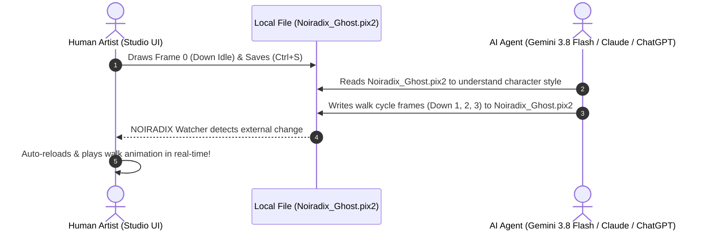

# PIX2 AI Authoring & Cognitive Reference Guide v1.0
## Instructions for Large Language Models & Autonomous Agents

> **Audience:** Any AI agent, LLM, or programmatic code generator tasked with creating, reading, validating, or modifying pixel art sprites.  
> **Key Principle:** PIX2 is not an image prompt. It is deterministic, addressable sprite code.

---

## 1. The Core Mental Model for AI

When you are asked to "create a sprite" or "modify a sprite" in PIX2:
1. **Never generate an image or diffusion matrix.** You are writing structured PIX2 code.
2. **Every pixel is a discrete integer coordinate $(x, y)$.**
3. **Never generate an implicit background.** Transparent pixels do NOT exist in the file. Only drawn pixels exist.
4. **Coordinate Origin:** Top-left is $(0, 0)$.
   - $X$ increases from left to right: $0 \le x < \text{width}$.
   - $Y$ increases from top to bottom: $0 \le y < \text{height}$.
5. For a standard $16 \times 16$ sprite cell, valid indices are $x \in [0, 15]$ and $y \in [0, 15]$.

---

## 2. Standard PIX2 File Template

Every `.pix2` file generated by an AI must follow this canonical structure:

```pix2
@pix2 1.0

@meta
  title: "Player"
  author: "dotlinux26"
  version: "1.0"
  color_mode: "RGBA"
  coordinate_origin: "top-left"

@grid
  columns: 4
  rows: 4
  default_cell: 16x16
  gap: 1
  background: none

@palette
  white: #FFFFFF
  outline: #57546F
  shade: #DDE8EF
  blush: #FFB0BC
  eye: #46435C

@cell down_0
  name: "Down Idle 0"
  direction: down
  frame: 0
  size: 16x16

  ; Head dome
  pixel 6,2 outline
  pixel 7,2 white
  pixel 8,2 white
  pixel 9,2 outline

  ; Eyes & face
  pixel 5,3 outline
  pixel 6,3 white
  pixel 7,3 eye
  pixel 8,3 eye
  pixel 9,3 white
  pixel 10,3 outline

@animation walk_down
  name: "Walk Down"
  direction: down
  frames: [down_0, down_1, down_2, down_3]
  fps: 6
  loop: true

@end
```

---

## 3. Surgical AI Operations (Pixel Addressing)

When an AI receives an editing instruction, it MUST perform surgical operations rather than rewriting unrelated parts.

### Operation 1: Set Pixel (`set_pixel`)
To set a pixel at coordinate $(x, y)$ in cell `cell_id`:
```
Player.down_0.pixel(7, 3) = #FFFFFF
```
In PIX2 syntax:
```pix2
@cell down_0
  pixel 7,3 #FFFFFF
```

### Operation 2: Erase Pixel (`erase_pixel`)
To make a pixel transparent at coordinate $(x, y)$, **simply remove its record**:
```
erase Player.down_0.pixel(7, 3)
```
*(In PIX2, non-existent coordinate = 100% transparent)*.

### Operation 3: Replace Color (`replace_color`)
To recolor all occurrences of a palette color:
```
replace_color(cell: down_0, from: outline, to: #222233)
```

### Operation 4: Move / Shift Region (`move_region`)
To translate a bounding box $(\Delta x, \Delta y)$:
For every $(x, y)$ in region, replace with $(x + \Delta x, y + \Delta y)$.

### Operation 5: Symmetry Mirror (`mirror_cell`)
For a horizontal symmetry axis $X_{\text{axis}} = \frac{W - 1}{2}$:
For each pixel at $(x, y)$, mirror coordinate is $(2 \cdot X_{\text{axis}} - x, y) = (W - 1 - x, y)$.

---

## 4. Canonical Coordinate & Bilateral Symmetry Reference Table

In PIX2, discrete grid indexing starts strictly at `0`. When placing pixels or mirroring symmetrical sprites with `sym_dot`, the center axis is mathematically exact:

$$\text{axisX} = \frac{W - 1}{2}$$

| Cell Resolution | Valid Coordinates | Center Axis (`axisX`) | Bilateral Symmetry Macro | Reflection Math |
|:---:|:---:|:---:|:---|:---|
| **$16 \times 16$** | `0` to `15` | `X = 7.5` | `sym_dot x,y 7.5 <color>` | $x' = 15 - x$ |
| **$24 \times 24$** | `0` to `23` | `X = 11.5` | `sym_dot x,y 11.5 <color>` | $x' = 23 - x$ |
| **$32 \times 32$** | `0` to `31` | `X = 15.5` | `sym_dot x,y 15.5 <color>` | $x' = 31 - x$ |
| **$64 \times 64$** | `0` to `63` | `X = 31.5` | `sym_dot x,y 31.5 <color>` | $x' = 63 - x$ |
| **$W \times H$ (Custom)** | `0..W-1`, `0..H-1` | `axisX = (W-1)/2` | `sym_dot x,y axisX <color>` | $x' = (W - 1) - x$ |

---

## 5. Solid Sprite Mass Mandate (Strictly No Hollow Wireframes)

> [!IMPORTANT]
> **Mandatory Solid Interior:** Pixel art sprites are solid physical entities with volume, mass, and depth — NOT hollow wireframes or wire outlines!  
> The interior of the head, face, torso, clothing, and limbs MUST be 100% packed with solid color pixels.  
> **Forbidden:** Drawing an outline ring with an empty or transparent interior. An empty ring makes the sprite look like an invisible ghost wireframe.

### Speed Strategy for Solid Fills in PIX2:
1. **Solid Torso & Robe Fills:** Use `rect x,y w,h <color> fill` to lay down a solid body block in 1 single instruction.
2. **Symmetrical Fills:** Use `sym_dot x,y axisX <color>` for symmetrical eye, cheek, and shoulder highlights.
3. **Cohesive 5-6 Tone Palette:**
   - Tone 1: Dark Slate Outline (e.g. `#110e1e` or `#2b1f42`)
   - Tone 2: Deep Core Shadow (e.g. `#4d3a70`)
   - Tone 3: Midtone Body Fill (e.g. `#8066b3`)
   - Tone 4: Rim Highlight (e.g. `#a5f3fc`)
   - Tone 5: Glowing Eyes / Accent (e.g. `#00f0ff`)

---

## 6. Anti-Lazy 4-Frame Locomotion Formulas

When animating sprites, every single frame in a sequence must exhibit active physical displacement. Never leave duplicate or static frames!

### Walking Locomotion Formula:
- **Frame 0 (Contact Idle):** Base neutral stance, feet together or touching ground ($Y = H - 2$).
- **Frame 1 (Step Left):** Torso dips down 1 pixel ($\Delta Y = +1$ or $-1$ bob), left foot extends forward, arms swing.
- **Frame 2 (Passing Pose):** Body rises to apex ($Y_{\text{base}} - 1$), feet cross center.
- **Frame 3 (Step Right):** Torso dips down 1 pixel, right foot extends forward, opposite arm swing.

### Ghost / Floating / Flying Sway Formula:
- **Frame 0 (Hover High):** Apex hover height ($Y - 1$), tail wisps centered.
- **Frame 1 (Sway Right):** Neutral height ($Y$), wisps trail to the right ($\Delta X = +1$).
- **Frame 2 (Hover Dip):** Low dip ($Y + 1$), wisps compress and flare outward.
- **Frame 3 (Sway Left):** Neutral height ($Y$), wisps curl to the left ($\Delta X = -1$).

---

## 7. The 5 Specialized AI Prompt Templates

NOIRADIX Studio equips artists and LLMs with 5 context-tailored prompt modes selectable directly from the Studio interface:

### Mode 0: 🌟 All-in-One Master Prompt (Complete Cognitive Guide + All Recipes)
* **Goal:** Encyclopedic reference incorporating coordinate bounds, dynamic anatomy landmarks, bilateral symmetry table, solid mass mandates, and all locomotion recipes in a single self-contained prompt.

### Mode 1: 🧙‍♂️ Full Character (4-Dir / 8-Dir Generation)
* **Goal:** Generate a complete game character from scratch with directional faces and walk animations.
* **Instructional Focus:**
  - Establishes a harmonious 4 to 8 color `@palette` (Outline, Base, Highlight, Shadow, Accents).
  - Enforces bilateral symmetry on frontal views (`down_0`) using `sym_dot`.
  - Enforces silhouette consistency across all 4 cardinal directions (`down`, `up`, `right`, `left`).
  - Automatically hooks up walk cycles (`walk_down`, `walk_up`, `walk_right`, `walk_left`) at 6fps loop.

### Mode 2: 🎬 Walk Cycle & Locomotion Animation
* **Goal:** Produce smooth, natural locomotion frames from a static reference pose.
* **Instructional Focus:**
  - Discrete bobbing physics: Frame 1 & Frame 3 apply a 1-pixel torso offset ($\Delta Y = -1$) to simulate step impact.
  - Foot swing dynamics: Leading foot stretches forward, trailing foot pulls back with passing contact.
  - Secondary motion: Cloaks, tails, antennae, and hair trailing motion lagged by 1 frame.

### Mode 3: 🗡️ Accessory & Equipment Overlay
* **Goal:** Equip characters with hats, helmets, wings, cloaks, and weapons without breaking base silhouette.
* **Instructional Focus:**
  - Non-destructive overlays: Preserves existing character anatomy pixels unless intentionally covered.
  - Primitives: Utilizes `line x0,y0 x1,y1 <color>` for weapon handles and blades.
  - Palette integration: Adds distinct material colors (e.g. golden steel, polished silver, ruby gems).

### Mode 4: 🩹 Surgical Frame / Color Patch
* **Goal:** Apply targeted fixes to specific cells or color schemes with minimal token consumption.
* **Instructional Focus:**
  - Output ONLY modified `@cell <id>` or `@palette` directives rather than regenerating the entire document.
  - Eliminates regression risks on unrelated frames and reduces LLM latency.

---

## 7. Real-Time Human-AI Live Collaboration Protocol

NOIRADIX Studio supports bidirectional, zero-latency co-authoring between human artists and AI agents:



### Best Practices for AI Agents Writing to Disk:
1. **Preserve Document Metadata:** Keep existing `@meta` title, grid dimensions, and cell dimensions untouched unless requested.
2. **Reuse Existing Palette IDs:** If white is defined as `1`, do not define a duplicate white as `6`.
3. **Format Determinism:** Keep `@cell` declarations in sequential grid order (`cell_0_0`, `cell_0_1`, etc.).
4. **Single-File Completeness:** Ensure the written `.pix2` file passes `PIX2.validate()` without dangling frame references.

---

## 8. Real-World Case Study: Creating `Noiradix_Ghost.pix2` with Gemini 3.8 Flash

The official mascot template [`samples/Noiradix_Ghost.pix2`](../../samples/Noiradix_Ghost.pix2) serves as the primary benchmark in NOIRADIX Studio, **entirely authored and drawn by Gemini 3.8 Flash** using the `.pix2` language:
1. **Design Target:** A cute, friendly ghost character with raised waving arms and sparkles, matching `noiradix-studio-logo.svg`.
2. **Mathematical Walk Cycle Synthesis:**
   - **Down Walk (`cell_0_0` .. `cell_0_3`):** Synthesized using bilateral symmetry (`sym_dot`), dark expressive eyes (`#46435c`), blush cheeks (`#ffb0bc`), and undulating waving arms (bobbing Y: 0 to 1).
   - **Up Walk (`cell_1_0` .. `cell_1_3`):** Back view showing cowl folds and trailing ghost wisps, strictly omitting all eyes and blush.
   - **Right & Left Walk (`cell_2_x` & `cell_3_x`):** 3/4 side profiles featuring trailing tails and reaching arms.
3. **Token Efficiency:** Only explicitly drawn pixels are serialized (~370 lines of structured text), achieving 100% roundtrip determinism and zero LLM hallucination.
