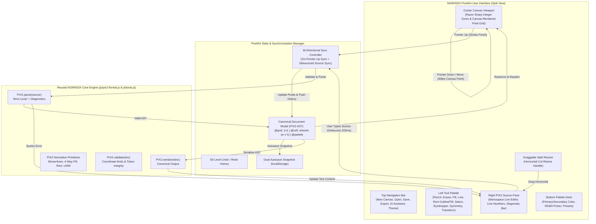

# NOIRADIX PixelArt — System Architecture & Code Reuse Plan

**Document ID:** `docs/PIXELART/ARCHITECTURE_AND_REUSE_PLAN.md`  
**Version:** 1.3.0  
**Author:** Nguyen Duc Canh (@dotlinux26) & Pair Assistant  
**Date:** 2026-11-08  
**Target URL:** `https://noiradix.me/pixelart/`  
**Status:** Approved Architectural Blueprint  

---

## 1. Executive Summary & Vision

### 1.1 The Pivot from Spritesheet Animation to Pure 2D Pixel Artwork
NOIRADIX Studio was conceived and completed as a specialized tool for indie game developers: slicing spritesheets, previewing 4-direction/8-direction walking animations, and 1-click exporting to Unity 2D (`.png` atlas + `.cs` Animator controller importer).

**NOIRADIX PixelArt** represents a sibling application in the NOIRADIX ecosystem. Rather than managing multi-frame locomotion rows or atlas spacing, PixelArt focuses on **a single standalone canvas** dedicated to pure 2D pixel art painting, illustration, and structured visual programming.

### 1.2 "Canvas là Vua, Code là Đầy Tớ" — The Human-Centered Philosophy
A human artist does not sit down to write lines of text coordinates like `p 512,320 #ff0000` — humans think in forms, colors, proportions, and strokes. In NOIRADIX PixelArt:
* **The Canvas is Primary:** Artists spend 99% of their time drawing with a mouse or pen tablet (pencil, flood fill, line, rect, selection).
* **The Code Pane is an Interface Layer:** The live `.pix2` source pane is not meant for manual typing of thousands of pixels; it serves as a lightweight interchange gateway:
  1. **Instant Copy/Paste Project Sharing:** Send an entire pixel art project across Discord or chat in lightweight text without sending binary files.
  2. **The AI Bridge:** AI models (ChatGPT, Claude) lack human motor skills but excel at emitting structured `.pix2` code. The code pane accepts AI generation and renders it instantly onto the artboard.
  3. **Batch Code Tweaks (Coder-Artist Hacks):** Quick global color replacements (find-and-replace `#ff0000` with `#00ff00`) or coordinate adjustments.

---

## 2. Component Reuse Matrix

One of the greatest advantages of building NOIRADIX PixelArt within the same repository is that **the core engine, algorithms, and data formats are already rock-solid and verified by 134 automated tests**.

| NOIRADIX Studio Component | Reused in PixelArt? | Reuse Strategy & Implementation | Notes |
| :--- | :---: | :--- | :--- |
| **`js/pix2-format.js` (PIX2 Engine)** | **100% REUSED** | Imported directly via `<script src="../js/pix2-format.js">` | `PIX2.parse()`, `PIX2.serialize()`, `PIX2.validate()`, `PIX2.drawLineBresenham()`, `PIX2.floodFillCell()`, `normalizeHex()`, `hexToRgba()`, `MAX_COORD_ABS`, `MAX_CELL_DIM`. |
| **`js/tools.js` (Algorithms)** | **100% REUSED** | All algorithms reused: `line()`, `rect()`, `floodFill()`, `plotPixel()`, `erasePixel()`, `flipHorizontal()`, `flipVertical()`, `rotate90Clockwise()`, `nudge()`, `alignCenter()`. | Core geometric algorithms reused without duplication. |
| **Selection & Marquee System** | **100% REUSED** | Brought over from Studio: bounding box marquee, Select All (`Ctrl+A`), Copy (`Ctrl+C`), Cut (`Ctrl+X`), Paste (`Ctrl+V`), Fill selection (`F`), Delete selection. | Provides full artwork manipulation parity. |
| **Desktop Context Menu System** | **100% REUSED** | Desktop right-click menu (`.studio-context-menu`) ported with viewport clamping, outside dismiss, and actions (Cut, Copy, Paste, Select All, Fill, Flip H/V, Rotate 90, Center, Delete). | Decouples right-click drawing; color swapping moved to `X`. |
| **Palette Library & Custom Storage** | **100% REUSED** | Universal preset sync via `localStorage ('noiradix_custom_palettes')`, built-in presets (Noiradix Classic, PICO-8, Endesga 32, GameBoy, Sweetie 16, Solar Envy, DawnBringer 16/32, NES 54), "+ Save Current Palette to Library...". | Shared presets seamlessly work between Studio & PixelArt. |
| **File System Access API Engine** | **100% REUSED** | Native `showOpenFilePicker()` & `showSaveFilePicker()`, persistent `currentFileHandle`, direct single-keystroke `Ctrl+S` writeback, `Ctrl+Shift+S` Save As, and image import. | True native desktop file editing experience. |
| **Dual Autosave & Crash Recovery** | **100% REUSED** | State automatically saved to `localStorage` snapshot on every stroke and on 20s heartbeat. | Guarantees zero work loss on accidental tab close. |
| **`css/style.css` (Design System)** | **THEME REUSED** | CSS variables (`--bg-primary`, `--bg-secondary`, `--accent-primary`, `--border-subtle`, dark/light themes) shared for brand cohesion. | Custom split-view layout authored in `pixelart/css/pixelart.css`. |
| **`css/fontawesome/` & Webfonts** | **100% REUSED** | Linked directly via `<link rel="stylesheet" href="../css/fontawesome/all.min.css">` | Zero external CDN dependency; works 100% offline. |
| **`js/animation-player.js`** | **EXCLUDED (0%)** | Completely omitted from PixelArt. | PixelArt does not do sprite animation or timeline scrubbing. |
| **Atlas Grid & Unity Exporter** | **EXCLUDED (0%)** | Completely omitted from PixelArt. | No C# importer scripts, padding calculations, or slice gap logic needed. |

---

## 3. High-Level Architecture Diagram



---

## 4. Bi-Directional Synchronization Architecture

### 4.1 On-Pointer-Up Synchronization Policy
To guarantee sustained 60fps drawing responsiveness — even on $1024 \times 1024$ canvases with thousands of pixels:
1. **During `pointermove`:** The application draws directly into the canvas bitmap buffer. **Zero serialization occurs while dragging.** This keeps CPU overhead under 1ms per frame.
2. **On `pointerup`:** Once the stroke finishes, the document AST is updated, a history snapshot is recorded, and `PIX2.serialize(doc)` updates the source pane.
3. **Re-entrancy Lock (`isSyncing`):** Prevents recursive loops between the canvas and textarea.

### 4.2 Non-Destructive Source-to-Canvas Parsing
When an artist pastes code into the editor or edits directly:
* Input is debounced by 200ms (or applied instantly when clicking **`[ Apply ]`**).
* **Step 1 — Parse:** `PIX2.parse(source)` produces the structured AST document.
* **Step 2 — Validate:** `PIX2.validate(parsedDoc, { strict: false })` inspects the AST object for syntax, token, and coordinate integrity.
* **If valid:** The document AST updates active state, artwork dimensions adjust dynamically, palette swatches synchronize, canvas repaints, and the editor automatically locks back to View Only mode.
* **If invalid:** The canvas maintains the last valid artwork without clearing or corrupting the drawing, while the status pill surfaces the exact error code (e.g. `[PIX2_ERR_INVALID_COORDINATE]`).

### 4.3 Zero-Data-Loss Disk & Session Persistence Pipeline
To eliminate any risk of artwork disappearance upon page reload:
1. **Physical File Handle Retention:** Saving via Native File System Access API preserves `currentFileHandle` in IndexedDB (`noiradix_pixelart_db`).
2. **Reload Recovery Ladder:** On browser reload (<kbd>F5</kbd> / <kbd>Ctrl+R</kbd>), the editor checks:
   * **Level 1 (Disk Handle):** Reads directly from `persisted.getFile()` and applies source code to canvas.
   * **Level 2 (Disk Cache):** If permission is not yet re-granted, reads from `pix2_last_saved_content` in `localStorage`.
   * **Level 3 (Newer Autosave):** If the user made unsaved strokes after saving to disk, restores the newer autosaved snapshot (`pix2_pixelart_autosave`) and flags `isDirty = true`.
   * **Level 4 (Default):** Blank canvas if starting fresh.
3. **Real-Time 2-Way Title Sync:** Changing the artwork title immediately updates the file status pill and window title in real time.

### 4.4 Real-Time File Watcher & Conflict Engine (Studio Reuse)
Faithfully ported and reused from NOIRADIX Studio (`js/app.js`):
1. **Triple-Trigger Watcher Architecture:**
   * `focus`: Triggers whenever window focus is restored from an external IDE (VS Code, Cursor) or AI generator.
   * `visibilitychange`: Triggers when switching browser tabs.
   * `setInterval(1500ms)`: Background heartbeat polling during active viewing sessions.
2. **Conflict Resolution Strategy:**
   * If local state is clean (`!state.isDirty`): Auto-reloads external changes from disk silently into the canvas and code editor, showing a confirmation toast `⚡ Reloaded <file.name> from disk (external update detected)!`.
   * If local state is dirty (`state.isDirty`): Prevents destructive overwrite, displays warning toast `⚠️ "<file.name>" changed externally on disk! Click "Reload Disk" in status bar or Save to overwrite.`, and animates `#btn-reload-file` with `.pulse-warning`.
3. **Explicit Manual Reload (<kbd>Ctrl+Shift+R</kbd>):**
   * Prompts user with native `confirm()` before discarding unsaved canvas edits.
   * Clears `.pulse-warning` glow and re-synchronizes timestamps on completion.

### 4.5 High-Performance Engine for Large Canvases (Up to 1024×1024)
To ensure sustained 60 FPS drawing responsiveness even on dense $512 \times 512$ or $1024 \times 1024$ canvases with hundreds of thousands of active pixels:
1. **Hardware-Accelerated 1:1 Canvas Texture Blitting:**
   * Instead of iterating through tens of thousands of coordinate keys with string splitting (`key.split(',')`) and JavaScript `ctx.fillRect()` loops on every frame, PixelArt maintains a detached 1:1 HTML canvas buffer (`state.artworkCanvas`).
   * On repaint, a single call `ctx.drawImage(state.artworkCanvas, 0, 0, totalW, totalH)` blits the sprite to screen coordinates using nearest-neighbor scaling (`imageSmoothingEnabled = false`), leveraging the browser's hardware-accelerated 2D pipeline (without `{ willReadFrequently: true }` CPU readback de-optimizations).
2. **Incremental Stroke Plotting (`plotPixelOnBuffer`):**
   * Continuous mouse gestures update only the exact 1–4 affected pixels directly on the 1:1 buffer, eliminating full-canvas dictionary traversals during drag strokes.
3. **`requestAnimationFrame` Vsync Batching (`requestCanvasRepaint`):**
   * High-polling mice queue stroke points while rendering is strictly batched to the display vsync (60Hz / 120Hz / 144Hz / 240Hz), completely eliminating redundant rendering frames.
4. **Deferred / Lazy Serialization with Strict Export Flush:**
   * In Canvas Only mode (`state.viewMode === 'canvas'`), full text serialization (`_PIX2.serialize`) and DOM gutter generation are deferred during painting (`state.isSourceDirty = true`).
   * When saving (`saveFileNative`), downloading (`savePix2File`), copying code, or switching to Split/Code mode, `flushSourceCode()` forces an immediate synchronous flush (`syncCanvasToSource(true)`), guaranteeing zero stale source exports.
5. **DOM-Free Virtualized Code Gutter:**
   * Uses CSS `white-space: pre` and a single `textContent` string rather than tens of thousands of `<br>` DOM nodes, while caching line count to avoid redundant DOM updates during painting.
6. **Debounced Autosave (1000ms):**
   * Background snapshot serialization (`localStorage.setItem`) is debounced by 1 second during active drawing and flushed immediately on page unload.
7. **Pre-Rendered Floating Selection Buffers:**
   * Floating marquee pixels are cached onto an offscreen canvas (`state.floatingCanvas`) upon lifting, allowing 60 FPS multi-angle rotation and dragging via a single draw call.

---

## 5. Canvas Dimensions & 1024×1024 Hardware Sweet Spot

### 5.1 Native Browser & Hardware Performance Math
Why $1024 \times 1024$ is the optimal ceiling for browser-native Vanilla JavaScript:
* **RAM Footprint:** $1024 \times 1024 = 1,048,576\text{ pixels}$. In a 32-bit RGBA `Uint32Array` or `ImageData`, the entire canvas buffer requires exactly **4 MB of RAM**. Modern devices have 8GB–32GB RAM, making 4MB virtually imperceptible.
* **GPU Texture Optimization:** $1024$ is a power-of-two ($2^{10}$). Modern graphics chips (NVIDIA, AMD, Apple Metal, Intel Iris) optimize texture memory alignment specifically around power-of-two dimensions, delivering hardware-accelerated bilinear blits with zero penalty.
* **CPU Primitive Steps:** Bresenham lines at maximum diagonal span at most 1024 iterations, executing in under 0.2ms in V8.

### 5.2 Canvas Dimension Presets
* Micro & Game Sprites: $16 \times 16$, $24 \times 24$, $32 \times 32$, $48 \times 48$, $64 \times 64$
* Medium & Widescreen 16:9: $128 \times 128$, $192 \times 108$ (16:9), $256 \times 256$, $320 \times 180$ (16:9)
* Large & Hi-Bit: $512 \times 512$, $1024 \times 1024$
* Arbitrary custom width and height up to $1024 \times 1024$ supported.

---

## 6. High-Precision Razor-Sharp Grid Rasterization

Previous CSS-based background-image grid implementations suffered from subpixel floating-point drift and phase misalignment when zoomed.

In NOIRADIX PixelArt:
* The canvas buffer dimensions are set directly to `state.w * state.zoom` and `state.h * state.zoom`.
* Every pixel is drawn as an exact integer block of `zoom × zoom` pixels:
  ```javascript
  ctx.fillRect(px * zoom, py * zoom, zoom, zoom);
  ```
* Pixel grid lines are rendered with **half-pixel $(+0.5\text{px})$ offset** directly onto the canvas:
  ```javascript
  ctx.moveTo(Math.floor(x * zoom) + 0.5, 0);
  ctx.lineTo(Math.floor(x * zoom) + 0.5, totalH);
  ```
* This guarantees 100% mathematical grid alignment at every zoom level $\ge 8\times$ with zero subpixel blurring.

---

## 7. Draggable Split Pane Resizer

Between the artboard and code editor sits a draggable divider (`#pa-split-resizer`):
* Allows users to dynamically shrink the code pane when focused on painting, or expand it when reviewing source or AI output.
* Clamped between 200px and `window.innerWidth - 300px`.
* Width preference is automatically persisted in `localStorage ('pix2_pixelart_panel_width')`.

---

## 8. The Universal Responsive Drag-Scroll Pattern (Quy tắc Thiết kế Thanh ngang & Cột dọc Bất di Bất dịch)

A core UX requirement established for NOIRADIX PixelArt is that **no toolbar, header, statusbar, or palette deck should ever wrap, squish its contents, or show clunky native scrollbars**. 

To achieve this, the codebase enforces the **Twin Responsive Drag-Scroll Standard** across all horizontal bars and vertical toolbars:

### 8.1 Horizontal Drag-Scroll Standard (`enableHorizontalDragScroll`)
Applied to:
* Top Header (`.pa-header`)
* Canvas Statusbar (`.pa-canvas-statusbar`)
* Bottom Palette Deck (`.pa-palette-deck`)
* Palette Swatches Strip (`.pa-swatches-scroll`)

**The CSS Contract:**
```css
/* Container contract: single-line, auto horizontal scroll, hidden scrollbars */
.pa-horizontal-bar {
  display: flex;
  align-items: center;
  flex-wrap: nowrap;
  white-space: nowrap;
  overflow-x: auto;
  overflow-y: hidden;
  scrollbar-width: none;
  -ms-overflow-style: none;
}
.pa-horizontal-bar::-webkit-scrollbar {
  display: none;
}

/* Child group contract: absolutely prohibited from shrinking or wrapping */
.pa-child-group {
  display: flex;
  align-items: center;
  flex-shrink: 0;
  white-space: nowrap;
}
```

**The JavaScript Contract:**
* **Mouse Wheel:** Intercepts `wheel` events and adds `e.deltaY` to `container.scrollLeft`.
* **Pointer Drag:** Allows dragging on empty bar background to smoothly scroll left/right without triggering child buttons.

### 8.2 Vertical Drag-Scroll Standard (`enableVerticalDragScroll`)
Applied to:
* Left Tool Palette (`.pa-toolbar`)
* Preset Pickers & Modals

**The CSS Contract:**
```css
.pa-toolbar {
  width: 44px;
  min-width: 44px;
  display: flex;
  flex-direction: column;
  align-items: center;
  overflow-y: auto;
  overflow-x: hidden;
  scrollbar-width: none;
  -ms-overflow-style: none;
}
.pa-toolbar::-webkit-scrollbar {
  display: none;
}
.pa-tool-btn, .pa-tool-sep {
  flex-shrink: 0;
}
```

**The JavaScript Contract:**
* Handles natural mouse wheel and vertical background pointer drag to smoothly scroll tool columns on short displays (e.g. laptops, tablets).

---

## 9. Pixel-Aligned 1:1 Canvas Checkerboard Engine

Previous iterations relied on CSS `background-size: 16px 16px` on the viewport container. When zooming to non-factor levels (e.g. $11\times$, $7\times$), the CSS checkerboard crossed through the middle of pixels, causing severe moiré vibration and visual strain ("cay mắt").

### The Fix: Direct Canvas-Level Dynamic Checkerboard
The static CSS background was removed from `.pa-canvas-container` (`background: transparent`). Instead, `dom.ctxMain` renders the checkerboard directly prior to drawing pixel data:

```javascript
// Step size in canvas pixels:
// When zoom >= 4, each checker tile is EXACTLY 1 artwork pixel (zoom x zoom screen px)
// When zoom < 4, checker tile is an integer multiple of zoom (8x or 16x) to prevent fractional pixels
const tileArtPixels = zoom >= 4 ? 1 : (zoom === 1 ? 16 : 8);
const tileCanvasSize = tileArtPixels * zoom;

for (let cy = 0; cy < totalH; cy += tileCanvasSize) {
  for (let cx = 0; cx < totalW; cx += tileCanvasSize) {
    const col = Math.floor(cx / tileCanvasSize);
    const row = Math.floor(cy / tileCanvasSize);
    ctx.fillStyle = ((col + row) % 2 === 0) ? c1 : c2;
    ctx.fillRect(cx, cy, Math.min(tileCanvasSize, totalW - cx), Math.min(tileCanvasSize, totalH - cy));
  }
}
```

**Outcome:**
* When `zoom >= 4`, every checker square **IS** the artwork pixel!
* Razor-sharp $+0.5\text{px}$ grid lines align with 0% error on checker borders.
* Complete visual comfort with zero eye fatigue.

---

## 10. Analytical Invariant Cursor-Centered Zoom Formula

When zooming with the mouse wheel, the point on the canvas directly under the cursor must remain strictly stationary on the screen.

### Closed-Form Invariant Math:
```javascript
const rect = dom.canvasMain.getBoundingClientRect();
const unscaledX = (e.clientX - rect.left) / oldZoom;
const unscaledY = (e.clientY - rect.top) / oldZoom;

const deltaW = (state.w * (newZoom - oldZoom)) / 2;
const deltaH = (state.h * (newZoom - oldZoom)) / 2;
const shiftX = unscaledX * (newZoom - oldZoom);
const shiftY = unscaledY * (newZoom - oldZoom);

state.zoom = newZoom;
state.panX += Math.round(deltaW - shiftX);
state.panY += Math.round(deltaH - shiftY);
```
Regardless of cursor position (center, corners, edges, or outside canvas), the anchor point remains mathematically invariant.

---

## 11. Interactive Floating Selection & Geometric Transformations

Selection in NOIRADIX PixelArt supports full professional workflow:
1. **Marquee Drag:** Select region with animated dashed outline.
2. **Interactive Drag-to-Move:** Clicking inside an active selection picks up the pixels into a floating buffer (`state.floatingPixels`) and deletes them from the underlying cell. Moving the pointer renders the floating pixels smoothly on `dom.ctxPreview`.
3. **Commit on Action:** Clicking outside, switching tools, copy, paste, or pressing `Enter`/`Escape` stamps the floating pixels permanently into the cell at the new location and syncs with `.pix2` source.
4. **Selection-Aware Transformations:**
   * **Flip Horizontal:** If a selection is active, flips pixels inside the marquee across its vertical midline. Otherwise flips canvas.
   * **Flip Vertical:** If a selection is active, flips pixels inside the marquee across its horizontal midline. Otherwise flips canvas.
   * **Rotate 90° Clockwise:** If a selection is active, rotates pixels $90^\circ$ inside the bounding box and swaps marquee width/height. Otherwise rotates canvas.
   * **Nudge:** Arrow keys nudge the active selection or whole canvas by 1px.
   * **Delete / Clear:** Discards selection pixels.

---

## 12. Multi-Axis Alignment Suite

Provides 1-click geometric alignment of artwork content within the canvas bounds:
* **Align Left (`fa-align-left`):** Snaps leftmost drawn pixel to $X = 0$.
* **Align Right (`fa-align-right`):** Snaps rightmost drawn pixel to $X = W - \text{boxW}$.
* **Align Center Horizontal (`fa-align-center`):** Centers content on the horizontal axis.
* **Align Top (`fa-arrows-up-to-line`):** Snaps topmost drawn pixel to $Y = 0$.
* **Align Bottom (`fa-arrows-down-to-line`):** Snaps bottommost drawn pixel to $Y = H - \text{boxH}$.
* **Align Center Vertical (`fa-arrows-to-dot`):** Centers content on the vertical axis.
* **Align Center Both Axes (`fa-crosshairs`):** Centers content on both $X$ and $Y$ simultaneously.

---

## 13. Alois Zingl Midpoint Ellipse & Shape Engine

Implements Alois Zingl's normative integer Bresenham ellipse algorithm:
* **Circle / Ellipse Outline (`C`):** Renders single-pixel-wide closed ellipse contours without gaps or floats.
* **Filled Circle / Ellipse (`Shift+C`):** Computes scanline extents $[X_{\min}, X_{\max}]$ per $Y$ for solid rasterization.
* **Shift Modifier:** Constrains shape aspect ratio to $1:1$ (perfect square or perfect circle).
* **Alt Modifier:** Anchors shape at the starting drag coordinate, expanding outward symmetrically from center.

---

## 14. Summary of Engineering Commitments
1. **Complete Parity with Studio & Beyond:** Selection marquee, Cut/Copy/Paste/Fill, Drag-to-move selection, Rotate 90°, Flip H/V, Multi-axis alignment, Arrow key nudge, and Dual Autosave are fully supported.
2. **Unambiguous Iconography:**
   * Filled Rectangle: `<i class="fa-solid fa-square"></i>`
   * Filled Circle: `<i class="fa-solid fa-circle"></i>`
   * Symmetry H & V: Custom visual mirror-axis SVGs with dashed centerline.
   * Flip H & V: `<i class="fa-solid fa-arrows-left-right"></i>` and `<i class="fa-solid fa-arrows-up-down"></i>`.
3. **Twin Responsive Drag-Scroll Pattern:** Universal horizontal & vertical drag-scroll applied across all toolbars and statusbars.
4. **No Breaking Changes:** The PIX2 v1.0 Standard and NOIRADIX Studio remain frozen and verified by 134 automated unit and security tests.

---

## 15. Canvas Background Architecture & Dual Persistence Engine

### 15.1 Architectural Invariant: 60 FPS Render Pipeline
The background layer sits on Step 1 of `repaintCanvas()` before drawing artwork pixels:
1. **Mode `'transparent'` (Checkerboard):** Emits a pixel-crisp 1:1 checkerboard where each tile aligns to exactly 1 artwork pixel (`zoom x zoom` screen px) when $\text{zoom} \ge 4$, or integer multiples of zoom ($8 \times \text{zoom}$ or $16 \times \text{zoom}$) when $\text{zoom} < 4$. Zero fractional splits; eliminates moiré artifacts.
2. **Solid Modes (`'white'`, `'black'`, `'custom'`):** Single `fillRect(0, 0, totalW, totalH)` call. Executes in under $0.05\text{ ms}$, ensuring 60fps responsiveness.

### 15.2 Contrast-Adaptive Grid System
To ensure grid readability regardless of the chosen background color:
* If background is dark (solid black or custom hex with $YIQ < 128$): grid strokes are rendered as subtle semi-transparent white (`rgba(255, 255, 255, 0.15)`).
* If background is light (solid white or custom hex with $YIQ \ge 128$): grid strokes are rendered as subtle semi-transparent black (`rgba(0, 0, 0, 0.12)`).

```javascript
function isColorDark(hex) {
  if (!hex) return false;
  const clean = hex.replace('#', '');
  const r = parseInt(clean.substring(0, 2), 16) || 0;
  const g = parseInt(clean.substring(2, 4), 16) || 0;
  const b = parseInt(clean.substring(4, 6), 16) || 0;
  const yiq = ((r * 299) + (g * 587) + (b * 114)) / 1000;
  return yiq < 128;
}
```

### 15.3 Persistence Hierarchy
Background settings persist across two complementary vectors:
1. **Local Preferences (`localStorage`):** Keys `pix2_canvas_bg_mode` and `pix2_canvas_bg_color` store artist preference across sessions.
2. **PIX2 Document Serialization:** When serialized to text, `@grid background: none | #ffffff | #000000 | #hex` embeds the chosen style directly into the file. Upon loading or live-editing PIX2 code, the background directive dynamically configures the canvas without losing stroke data.

