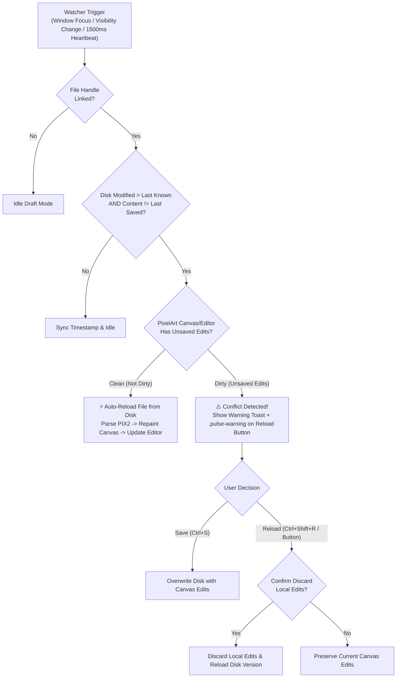

# NOIRADIX PixelArt — Functional & UI/UX Specification

**Document ID:** `docs/PIXELART/SPECIFICATION.md`  
**Version:** 1.6.0  
**Date:** 2026-11-08  
**Route:** `/pixelart/`  
**License:** Apache-2.0  

---

## 1. Product Overview

**NOIRADIX PixelArt** is an open-source, client-side, browser-based 2D pixel art editor featuring a live, two-way synchronized PIX2 source code editor.

* **Target Users:** Pixel artists, indie game creators, generative AI researchers, and developers who desire a clean, focused artboard for standalone illustrations with complete programmatic control over sprite coordinates.
* **Core Philosophy:** *Canvas là Vua, Code là Đầy Tớ* — Artists draw visually on the canvas; the human-readable `.pix2` code pane serves as an instantaneous interchange layer for copying/sharing projects in text, interfacing with generative AI, and inspecting pixel geometry.

---

## 2. Workspace Layout & User Interface

The workspace follows a responsive split-view architecture:

```
+----------------------------------------------------------------------------------------------------+
|  [Logo] NOIRADIX PixelArt [128x128]  |  New  Open  Save  Export  AI Assistant  |  [Split]  [Theme]  |
+----------------------------------------------------------------------------------------------------+
| Tools   | Canvas Artboard (Center)            |  Split  | Live PIX2 Source Code (Right)            |
| [Pencil]|                                     | Resizer | @pix2 1.0                                |
| [Eraser]|         +-------------------------+ | <=====> | @meta                                    |
| [Bucket]|         |                         | |         |   title: "Sunset Mountain"               |
| [Line]  |         |      /\                 | |         | @grid                                    |
| [Rect]  |         |     /  \       *        | |         |   columns: 1                             |
| [Fill-R]|         |    /    \     ***       | |         |   rows: 1                                |
| [Circle]|         |   /      \     *        | |         |   default_cell: 128x128                  |
| [Fill-C]|         |  /________\             | |         | @cell artwork                            |
| [Select]|         +-------------------------+ |         |   p 64,32 #ffe66d                        |
| [Picker]|                                     |         |   line 20,80 64,40 #ff6b8b               |
| [Pan]   |                                     |         | @end                                     |
| [Sym-H] |                                     |         |                                          |
| [Sym-V] |                                     |         |                                          |
| [Rotate]|                                     |         |                                          |
| [Flip-H]|                                     |         |                                          |
| [Flip-V]|                                     |         |                                          |
| [Align] |                                     |         | Status: [● Synced] (138 Pixels)          |
| Undo    | [Zoom: 12x] [-] [+] [Fit] [1x] (X,Y) |         | Diagnostics: Standard v1.0 Clean         |
+---------+-------------------------------------+---------+------------------------------------------+
| Palette: [Primary] [Secondary] [Swap]  #Hex [RGBA Slider]  | Status: [● Synced] (138 Pixels)      |
| Swatches: [ 1 ][ 2 ][ 3 ][ 4 ][ 5 ][ 6 ][ 7 ][ 8 ] [+]     | Diagnostics: Clean                   |
+----------------------------------------------------------------------------------------------------+
```

### 2.1 Top Navigation Bar
* **Brand Identity:** NOIRADIX logo icon + "NOIRADIX" title with `PixelArt` badge.
* **Return Link:** Quick button returning to NOIRADIX Studio (`../`).
* **Document Info:** Editable artwork title and current dimensions badge (e.g. `128×128 px`).
* **File Operations:**
  * **New Canvas (`Ctrl+N`):** Opens dimension picker modal with presets up to $1024 \times 1024$.
  * **Open File (`Ctrl+O`):** Reads `.pix2` file from disk via File System Access API or file input.
  * **Save / Download (`Ctrl+S`):** Downloads `.pix2` source.
  * **Export PNG:** Opens export modal with integer scale multipliers ($1\times, 2\times, 4\times, 8\times, 16\times, 32\times$).
* **AI Assistant:** Opens AI Prompt Generator & PIX2 Code Injector modal.
* **View Modes:** Split View (Dual Pane), Canvas Only, Code Only.
* **Theme Toggle:** Dark / Light mode with persistence in `localStorage`.
* **Universal Horizontal Drag-Scroll:** Protected with `flex-shrink: 0; white-space: nowrap;` and smooth mouse-wheel + background drag scrolling.

### 2.2 Left Toolbar & Feature Set
* **Pencil (`B`):** Freehand pixel drawing with continuous Bresenham interpolation between cursor samples.
* **Eraser (`E`):** Erases drawn pixels back to transparent.
* **Paint Bucket (`G`):** 4-way contiguous flood fill for closed regions.
* **Line Tool (`L`):** Renders straight lines using normative PIX2 Bresenham rasterization with real-time drag preview.
* **Rectangle Outline Tool (`U`):** Draws rectangular outlines (`<i class="fa-regular fa-square"></i>`). Holds `Shift` for 1:1 square, `Alt` to expand from center point outward.
* **Filled Rectangle Tool (`Shift+U`):** Draws filled rectangles using the standard solid square icon (`<i class="fa-solid fa-square"></i>`). Supports `Shift` and `Alt`.
* **Circle / Ellipse Outline Tool (`C`):** Integer Bresenham midpoint ellipse contour (`<i class="fa-regular fa-circle"></i>`). Holds `Shift` for 1:1 perfect circle, `Alt` to expand from center outward.
* **Filled Circle / Ellipse Tool (`Shift+C`):** Solid filled circle (`<i class="fa-solid fa-circle"></i>`). Supports `Shift` and `Alt`.
* **Selection Marquee Tool (`M` / `V`):**
  * Drag to select rectangular area with animated dashed marquee.
  * **Interactive Move/Drag:** Clicking inside active selection picks up pixels into a floating buffer, allowing smooth live drag-and-drop.
  * **Copy (`Ctrl+C`):** Copies selected pixels to clipboard.
  * **Cut (`Ctrl+X`):** Copies and clears selected region.
  * **Paste (`Ctrl+V`):** Pastes clipboard content at selection origin.
  * **Delete (`Delete` / `Backspace`):** Clears all pixels in selection.
  * **Fill Selection (`F`):** Fills all pixels in selection with active color.
* **Eyedropper (`I`):** Samples pixel color from canvas into primary color.
* **Hand / Pan Tool (`P` / `Space + Drag`):** Drags the canvas view freely across the viewport.
* **Bilateral Symmetry Guides (`H` / `Shift+H`):**
  * Horizontal Symmetry (Left ↔ Right): Dedicated SVG icon with vertical dashed mirror axis.
  * Vertical Symmetry (Top ↕ Bottom): Dedicated SVG icon with horizontal dashed mirror axis.
* **Geometric Transformation Engine:**
  * **Rotate 90° Clockwise (`R`):** Rotates selection if active, otherwise whole canvas.
  * **Flip Horizontal:** Mirrors selection if active across its midline, otherwise mirrors whole canvas.
  * **Flip Vertical:** Mirrors selection if active across its midline, otherwise mirrors whole canvas.
  * **Multi-Axis Alignment Suite:**
    * **Align Center (`fa-crosshairs`):** Centers content on both X & Y axes.
    * **Align Left (`fa-align-left`):** Snaps content to left canvas edge.
    * **Align Right (`fa-align-right`):** Snaps content to right canvas edge.
    * **Align Top (`fa-arrows-up-to-line`):** Snaps content to top canvas edge.
    * **Align Bottom (`fa-arrows-down-to-line`):** Snaps content to bottom canvas edge.
  * **Nudge Pixels (Arrow Keys):** Moves active selection or canvas pixels 1px up, down, left, or right.
* **Undo (`Ctrl+Z`) & Redo (`Ctrl+Y` / `Ctrl+Shift+Z`):** 50-level full document state history.
* **Clear Canvas:** Wipes current artboard with confirmation and history snapshot.
* **Vertical Drag-Scroll:** The toolbar supports smooth vertical scrolling on short screens (`enableVerticalDragScroll`).

### 2.3 Canvas Artboard, High-Precision Grid & Desktop Context Menu
* **Pixel-Aligned Checkerboard:** Rendered directly onto `dom.ctxMain`. At `zoom >= 4`, each checker tile is **EXACTLY** 1 artwork pixel (`zoom × zoom` screen px), eliminating all visual vibration/eye strain.
* **Razor-Sharp Normative Grid:** Grid lines are rendered directly onto the canvas with half-pixel $(+0.5\text{px})$ offset at zoom levels $\ge 4\times$, perfectly separating pixel boundaries.
* **Analytical Invariant Cursor Zoom:** Smooth mouse wheel zoom (1x to 64x integer multiples) mathematically invariant under the cursor position.
* **Separated Statusbar Geometry:** Features explicit 14px dividers (`.pa-status-divider`) with 6px margins and dedicated min-widths, guaranteeing zero collision between cursor coordinates, hover color (`Transparent` / hex), background style selector, grid toggle, and zoom controls on narrow panes.
* **Desktop Right-Click Context Menu (`#pa-context-menu`):** Right-clicking anywhere on the canvas or viewport opens a native desktop context menu featuring Cut (`Ctrl+X`), Copy (`Ctrl+C`), Paste (`Ctrl+V`), Select All (`Ctrl+A`), Deselect (`Esc`), Fill (`F`), Flip Horizontal (`H`), Flip Vertical (`Shift+H`), Rotate 90° Clockwise (`R`), Center Content, and Delete (`Del`).
* **Decoupled Secondary Color Drawing:** Secondary color painting via right-click has been decoupled in favor of the context menu. Artists effortlessly swap primary and secondary colors using the `X` key or the swap button.

### 2.4 Draggable Split Pane Resizer
* A dedicated horizontal resize bar (`#pa-split-resizer`) sits between the canvas pane and code pane.
* Drag horizontally to resize the code pane width (clamped between 200px and `window.innerWidth - 300px`).
* User's preferred width is automatically persisted in `localStorage`.

### 2.5 Live PIX2 Source Code Editor
* **Editor Features:** High-performance monospace text area with dynamic line numbering.
* **On-Pointer-Up Sync Policy:** Code only updates when a stroke is completed (`pointerup`), keeping drawing at a locked 60fps even on $1024 \times 1024$ canvases.
* **Non-Destructive Error Handling:** When users type incomplete code, canvas remains untouched and a diagnostic banner reports the error.
* **Direct Primitive Support:** Supports manual entry of `rect`, `line`, `fill`, `sym_dot`, `p`, and `dot`.

### 2.6 Palette Deck & Shared Custom Library
* **Dual Color Slots:** Primary color (Left click) and Secondary color. Quick swap via `X` shortcut or the swap button.
* **Color Controls:** Hex input field (`#RRGGBB` or `#RRGGBBAA`) and visual RGBA alpha slider (0-255).
* **Preset Palettes:** Noiradix Classic (8), PICO-8 (16), Game Boy (4), Sweetie 16, Endesga 32, Solar Envy (32), DawnBringer 16/32, NES 54.
* **Custom Palette Library (`localStorage` Sync):** Palettes saved in either NOIRADIX Studio or NOIRADIX PixelArt are universally stored under `noiradix_custom_palettes` and instantly accessible across both apps. Dedicated "+ Save Current Palette to Library..." and `#btn-save-palette` allow naming and archiving custom palettes.
* **Custom Swatches:** Click swatch to select; right-click swatch to replace with current color; click `+` to append new color.
* **Auto-Synchronization:** Swatches automatically serialize into the `@palette` section of the `.pix2` document.
* **Universal Drag-Scroll Architecture:** Smooth drag and wheel scrolling across colors and palette presets with hand grab/grabbing cursor feedback.

### 2.7 Native File System Access API & Zero-Data-Loss Persistence
* **Direct File Handle Tracking (`currentFileHandle`):** Native `showOpenFilePicker()` and `showSaveFilePicker()` integration.
* **Single-Keystroke Overwrite (`Ctrl+S`):** Directly writes back to the opened file without annoying save prompts when permissions are granted.
* **Save As (`Ctrl+Shift+S`):** Prompts for new filename or location while maintaining session state.
* **Automatic Title & Filename Sync:** Document title input (`#pa-doc-title`), file status pill (`#pa-file-path-text`), and browser window title dynamically synchronize in real time (`artwork.pix2 — NOIRADIX PixelArt`).
* **IndexedDB File Handle Persistence:** The active file handle is safely persisted in IndexedDB (`pix2_pixelart_store`). When refreshing the browser (<kbd>F5</kbd> / <kbd>Ctrl+R</kbd>), the editor automatically restores directly from the physical disk file handle or cached content.
* **Intelligent Crash & Reload Protection:** Prioritizes newer autosaved drafts if unsaved changes were made before reload, ensuring zero lost strokes.
* **Universal Fallbacks:** Automatic fallback to standard `<input type="file">` and Blob downloads on unsupported platforms (e.g. mobile/older Safari).

---

## 3. Keyboard Shortcuts Reference

| Shortcut | Action | Notes |
| :--- | :--- | :--- |
| `Right-Click` | Open Desktop Context Menu | Transform, Edit, Select actions |
| `Ctrl + A` | Select Entire Canvas | Full canvas marquee bounding box |
| `Escape` | Deselect / Dismiss Context Menu | Clears selection or floating buffer |
| `B` | Pencil Tool | Freehand continuous pixel drawing |
| `E` | Eraser Tool | Erases pixels back to transparent |
| `G` | Flood Fill Tool | 4-way contiguous region fill |
| `L` | Line Tool | Normative Bresenham line with live preview |
| `U` | Rectangle Outline Tool | Hold `Shift` for square, `Alt` for center expansion |
| `Shift + U` | Filled Rectangle Tool | Solid rectangle |
| `C` | Circle / Ellipse Outline Tool | Hold `Shift` for circle, `Alt` for center expansion |
| `Shift + C` | Filled Circle / Ellipse Tool | Solid ellipse |
| `Hold Shift` | Constrain 1:1 Aspect Ratio | For shapes & 15° rotation snapping |
| `Hold Alt` | Expand Shape from Center Outward | For Rectangle and Circle tools |
| `M` / `V` | Selection Marquee Tool | Drag to select; drag inside to move floating pixels |
| `I` | Eyedropper / Color Picker | Samples canvas color to primary slot |
| `H` (without Shift) | Hand / Pan Tool | Drags canvas view across viewport (or hold `Space`) |
| `Shift + H` | Toggle Horizontal Symmetry | Mirrors across vertical center axis |
| `Shift + V` | Toggle Vertical Symmetry | Mirrors across horizontal center axis |
| `S` (without Ctrl) | Toggle Bilateral Symmetry | Quick shortcut for bilateral symmetry mode |
| `R` | Rotate 90° Clockwise | Rotates selection if active, otherwise entire canvas |
| `Drag Rotation Knob` | Free Multi-Angle Rotation | Drag stem knob at selection top; hold `Shift` for 15° snap |
| `Arrows` | Nudge Pixels / Selection | 1px offset in arrow direction |
| `Ctrl + C` / `Ctrl + V` | Copy / Paste Selection | Clipboard support |
| `Ctrl + X` | Cut Selection | Copies and clears selection |
| `Delete` / `Backspace` | Clear Selection / Delete Floating Pixels | Wipes selected region |
| `F` | Fill Selection | Fills selection with primary color |
| `Enter` | Commit Floating Selection | Stamps floating pixels down onto artwork |
| `X` | Swap Primary & Secondary Colors | Immediate slot interchange |
| `Ctrl + Z` | Undo | 50-level full document state history |
| `Ctrl + Y` / `Ctrl + Shift + Z` | Redo | Forward history stack |
| `Ctrl + S` | Save File | Direct disk writeback or download |
| `Ctrl + Shift + S` | Save As | File System Access API picker |
| `Ctrl + O` | Open File | Native picker for `.pix2`, `.png`, `.jpg` |
| `Ctrl + N` | New Canvas Modal | Custom dimension setup |
| `Mouse Wheel` | Invariant Cursor-Centered Zoom | 1x to 64x integer magnification |

---

## 4. Canvas Dimension Presets (1 to 1024 px)

* $16 \times 16$ — Micro sprite
* $24 \times 24$ — Classic RPG icon
* $32 \times 32$ — Standard character portrait
* $48 \times 48$ — Isometric asset
* $64 \times 64$ — Detailed avatar / mob
* $128 \times 128$ — Large artwork / illustration
* $192 \times 108$ — 16:9 Widescreen landscape
* $256 \times 256$ — Complex game backdrop
* $320 \times 180$ — Full 16:9 indie start screen
* $512 \times 512$ — Hi-bit master artwork
* $1024 \times 1024$ — Epic grand landscape / maximum hardware sweet spot

---

## 5. User-Configurable Canvas Background Modes

To ensure optimal contrast and eye comfort across different art styles (e.g. bright characters, dark silhouettes, game assets), the canvas background style is fully configurable via the Statusbar selector:

| Mode | Visual Presentation | Grid Line Adaptation | PIX2 Source Directives | Persistence Key |
| :--- | :--- | :--- | :--- | :--- |
| **`transparent`** (Default) | 1:1 Pixel-Aligned Checkerboard | Theme adaptive (`rgba(0,0,0,0.12)` or `rgba(255,255,255,0.12)`) | `@grid` $\to$ `background: none` | `pix2_canvas_bg_mode = "transparent"` |
| **`white`** | Solid Pure White (`#ffffff`) | High-contrast subtle dark grid (`rgba(0,0,0,0.12)`) | `@grid` $\to$ `background: #ffffff` | `pix2_canvas_bg_mode = "white"` |
| **`black`** | Solid Pure Black (`#000000`) | High-contrast subtle light grid (`rgba(255,255,255,0.15)`) | `@grid` $\to$ `background: #000000` | `pix2_canvas_bg_mode = "black"` |
| **`custom`** | User-selected Custom Hex Color | Dynamic YIQ luminance adaptive grid | `@grid` $\to$ `background: #<hex>` | `pix2_canvas_bg_mode = "custom"`, `pix2_canvas_bg_color = "#hex"` |

### 5.1 Bi-Directional Source Code Synchronization
* Setting a background mode automatically synchronizes the `@grid background:` property in the `.pix2` source editor.
* Editing or typing `background: none | #ffffff | #000000 | #hex` in the code editor immediately updates the visual canvas background mode and activates the matching UI button.

### 5.2 PNG Exporter Integration
* **Pure Alpha Export (Default):** Generates transparent RGBA `.png` files suitable for game engines and sprite workflows.
* **Canvas Background Option:** A dedicated checkbox in the PNG Export modal allows baking the chosen solid white, solid black, or custom background color directly into the final raster image.

---

## 6. Selection & Transformation System (Marquee & Rotation)

### 6.1 Reliable Single-Cell & Multi-Cell Marquee
* **Single-Pixel Selection:** Clicking on an individual canvas pixel reliably selects that exact 1-pixel cell (`w: 1, h: 1`) without prematurely deselecting or wiping out the marquee on pointer release.
* **Crystal-Sharp Rendering (Zero Subpixel Blur):**
  * When $W = 1 \text{ and } H = 1$, the marquee renders with a solid high-contrast `#4f46e5` border, soft purple scrim (`rgba(99, 102, 241, 0.18)`), and an interior highlight, completely eliminating fragmented/blurry dashes at high zoom.
  * When $W > 1 \text{ or } H > 1$, rendering uses integer pixel alignment (`Math.floor(x * zoom) + 0.5`) with a 1px solid dark underlay, crisp dashed overlay (`[4, 4]`), and 4 corner grip handles.
* **Select All (`Ctrl+A`):** Instantly bounds the entire canvas dimensions ($0, 0, W, H$).

### 6.2 Selection Rotation (90° Clockwise & Free Multi-Angle)
* **Clockwise 90° Keyboard Rotation (`R`):**
  * Pressing `R` or clicking the Rotate button transforms the active selection:
    * Pixel coordinates map to $(H - 1 - Y, X)$.
    * Bounding box width and height swap ($W' = H, H' = W$).
    * Automatically triggers history snapshot creation (`pushHistory()`), source code synchronization, and autosave.
    * If no selection is active, rotating rotates the entire canvas artwork.
* **Free Multi-Angle Rotation Handle (Stem + Circular Pivot):**
  * Top-center of the marquee features a dedicated rotation stem and circular pivot knob.
  * **Hover Feedback:** Hovering over the knob turns the cursor into `grab`.
  * **Interactive Drag (60 FPS):** Dragging turns the cursor into `grabbing` and smoothly rotates floating pixels and the marquee box around the center in real-time.
  * **Live Angle Readout:** Displays the exact rotation angle in degrees (e.g. `30°`, `45°`, `90°`) directly above the knob.
  * **Angle Snapping (`Shift`):** Holding `Shift` snaps rotation to 15° increments (0°, 15°, 30°, 45°, 60°, 75°, 90°, etc.).
  * **Nearest-Neighbor Inverse Sampling with Tight Bounding-Box Cropping:**
    * When released (`pointerup`), the rotated pixels are rasterized using normative inverse rotation.
    * If the rotation is near a 90° multiple, $W$ and $H$ strictly swap ($W \leftrightarrow H$) without floating-point inflation.
    * The new selection bounds automatically **tight-crop to the actual non-empty pixels**, completely preventing repeated rotations from ballooning the bounding box with empty padding.

---

## 7. Safe View Mode & Auto-Lock on Apply

To prevent accidental code erasure when inspecting the code editor, the editor is protected by a streamlined, single-click locking mechanism:

| State | Badge | Editor Attribute | Header Action | Capabilities |
| :--- | :--- | :--- | :--- | :--- |
| **View Only (Default)** | `<i class="fa-solid fa-lock"></i> View Only` | `readonly` | Displays **`[ Edit ]`** button | Safe inspection, text selection, `Ctrl+C` copying, and downloading. Accidental typing or backspacing is completely blocked. |
| **Editing Unlocked** | `<i class="fa-solid fa-pen"></i> Editing` | Not `readonly` | Displays **`[ Apply ]`** button (accent) | Direct source editing. Clicking `Apply` validates the PIX2 AST, updates canvas artwork, and **automatically locks the editor back to View Only** in one click (no redundant Lock button). |

* **Non-Destructive Syntax Validation:** If manual edits contain syntax errors, the canvas remains completely intact and the status bar displays the exact error diagnostic pill (e.g. `● Syntax Error`).
* **Fullscreen Code Expansion:** Switching to the Code-only view mode (`view-code-only`) automatically expands the editor pane to 100% of the viewport width, overriding split-pane inline pixel styles.

---

## 8. Alignment Guidelines (Trục Dóng Tâm Giữa)

The canvas statusbar features dedicated alignment guideline toggles:
* **Center Crosshairs (`Center`):** Draws both horizontal ($Y = H/2$) and vertical ($X = W/2$) dashed cyan (`#06b6d4`) center lines with a central target reticle.
* **Vertical Guide (`V-Guide`):** Draws a vertical centerline at $X = W/2$.
* **Horizontal Guide (`H-Guide`):** Draws a horizontal centerline at $Y = H/2$.
* Guidelines are rendered crisply on the canvas overlay, remaining independent of the active drawing layer and omitted from PNG exports.

---

## 9. Universal Horizontal Drag-Scroll & UI Refinement

* **Grab & Grabbing Interaction:** All horizontal bars across the interface—including `.pa-header`, `.pa-canvas-statusbar`, `.pa-palette-deck`, `.pa-swatches-scroll`, `.pa-code-header`, and `.pa-code-statusbar`—support smooth horizontal drag-scroll via mouse pointer drag or wheel tilt.
* **Palette Save Button:** Styled as a clean, borderless bookmark icon (`fa-solid fa-bookmark`) whose height perfectly matches the 26px dropdown select element, avoiding bulky button backgrounds.

---

## 10. Real-Time File Watcher & Conflict Resolution System

Faithfully reusing the proven external file-watcher architecture from **NOIRADIX Studio** (`js/app.js`), PixelArt maintains flawless synchronization between local disk files and the in-browser canvas/code editor when external tools (VS Code, external AI agents, scripts) modify the `.pix2` file on disk:



### 10.1 Triple-Trigger Watcher Engine
1. **Window Focus (`window.addEventListener('focus')`):** Instantly triggers a check the millisecond the artist switches from an external editor or AI chat back to the browser tab.
2. **Tab Visibility (`document.addEventListener('visibilitychange')`):** Detects when the browser tab comes back into view.
3. **Heartbeat Polling (`setInterval(1500ms)`):** Silently inspects file timestamps every 1.5 seconds if the document is active, enabling real-time collaboration across dual monitors without requiring window focus toggles.

### 10.2 Conflict Detection & Visual Pulse Warning
* **Safe Automatic Reload (Clean State):** If the artist has made no local unsaved edits, PixelArt immediately updates the code editor and canvas artwork without interrupting the workflow, displaying a toast notification: `⚡ Reloaded <file.name> from disk (external update detected)!`.
* **Protective Conflict Warning (Dirty State):** If the canvas contains unsaved strokes, PixelArt **never** silently destroys user work. Instead:
  * Triggers a warning toast: `⚠️ "<file.name>" changed externally on disk! Click "Reload Disk" in status bar or Save to overwrite.`.
  * Activates an attention-grabbing amber glow animation (`.pulse-warning`) on the `#btn-reload-file` button.
  * Preserves all local canvas and editor strokes until the user explicitly decides to overwrite (`Ctrl+S`) or reload (`Ctrl+Shift+R`).

### 10.3 Manual Reload Confirmation
* Clicking `#btn-reload-file` or pressing <kbd>Ctrl</kbd>+<kbd>Shift</kbd>+<kbd>R</kbd> checks whether local unsaved edits exist.
* If dirty, displays a native modal confirmation explaining that current in-browser edits will be discarded in favor of the external disk version.
* Upon confirming, clears the `.pulse-warning` class, reloads the disk content, and refreshes the canvas.


