# NOIRADIX Studio & PIX2 Master Documentation Portal

<div align="center">
  
  <h3>Canonical Technical Specifications, Architecture Guides & Engine Integrations</h3>
  <p><strong>A zero-dependency, AI-native structured sprite editor and directional animation suite</strong></p>
  <p>
    <a href="https://noiradix.me/"></a>
    <a href="https://github.com/dotlinux26/noiradix-studio/actions/workflows/deploy.yml"></a>
  </p>
</div>

---

## 📸 Studio Visual Tour

Experience desktop-grade pixel art creation directly in your browser with zero installation:

### 🌟 60-Second Full Walkthrough (From AI Prompt to Unity 2D)

https://github.com/user-attachments/assets/5098357c-daa5-44da-90a8-a1fc23f0c42f

*Comprehensive 60-second video walkthrough: Authoring sprites in NOIRADIX Studio, dynamic AI prompt generation, real-time directional animation playback, and 1-click Unity 2D package export.*

---

### 🚀 Live Workflow Preview: Browser to Unity 2D in 1 Click
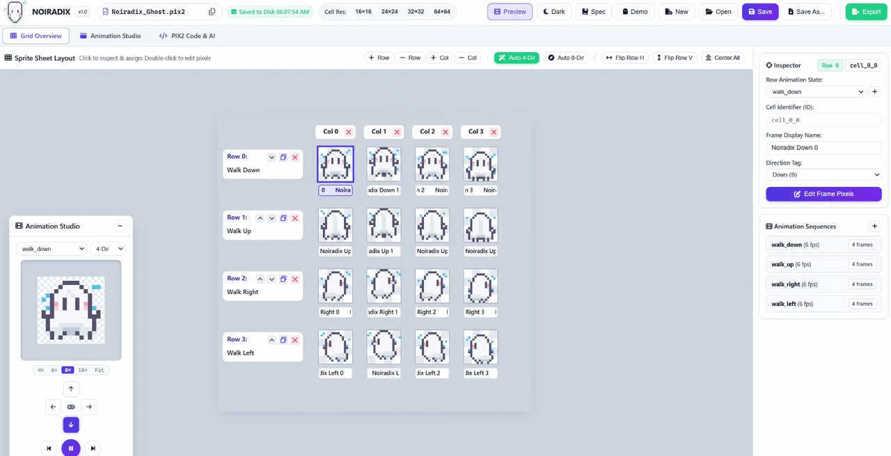
*Real-time demonstration of authoring sprite animations in NOIRADIX Studio, exporting the game package, and 1-click importing directly into Unity 6.*

---

### 1. Sprite Sheet Matrix & Multi-Frame Layout
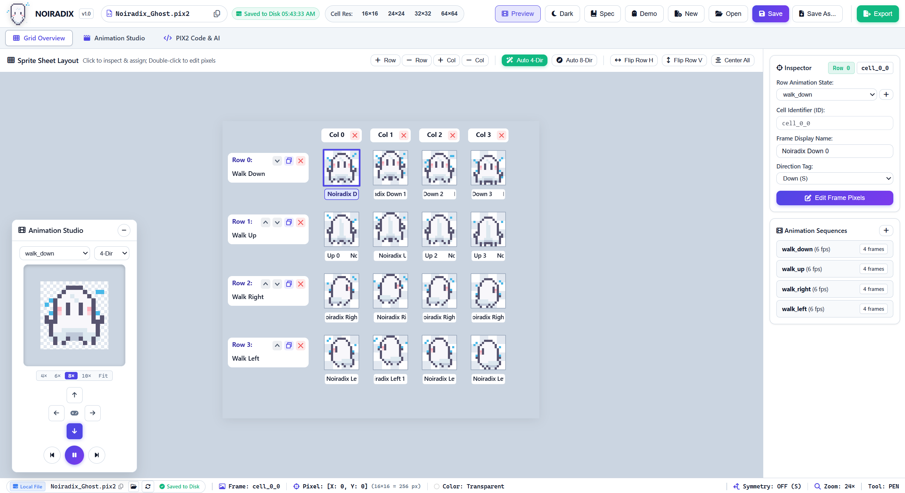
*Multi-cell grid matrix with row-level animation states, column frame sequences, resolution presets (16×16 to 64×64), and interactive Inspector panel.*

---

### 2. Directional Animation Studio (Real-Time Playback)
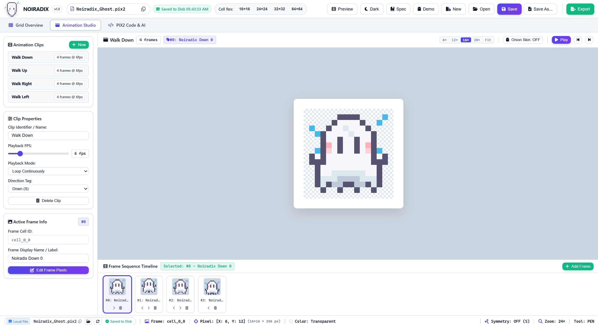
*Floating real-time playback player supporting 4-direction and 8-direction compass previews, variable FPS slider, and loop controls.*

---

### 3. Precision Pixel Editor with Rulers & Symmetry
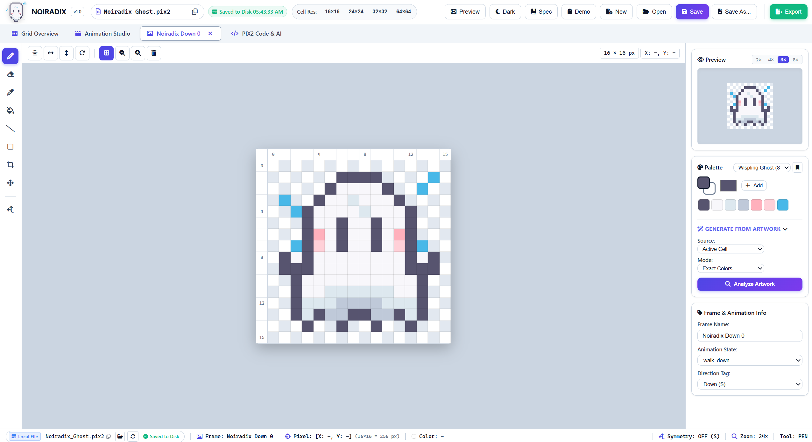
*Bilateral symmetry mirror axis (`sym_dot`), 4× to 64× anchor-centered zoom, dynamic pixel rulers, discrete drawing tools, and palette swatches.*

---

### 4. AI-Native PIX2 Code & 1-Click Prompt Studio
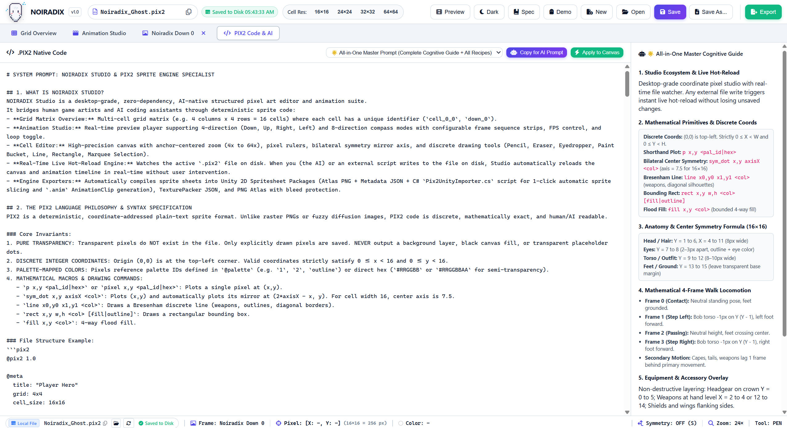
*1-Click "Copy Prompt for AI", token-efficient sparse `.pix2` syntax, zero-hallucination coordinates, and real-time disk hot-reload.*

---

## 🎮 Unity 2D Integration Step-by-Step

### Step 1: Configure & Export Unity 2D Package (.ZIP)
In NOIRADIX Studio, click **Export** in the top navigation bar. Select **Unity 2D Sprite Package** and configure your anti-bleed spacing (recommended: `1px Bleed Guard` with `Extrude Edge Pixels` checked). Click **Export Unity 2D Package (.ZIP)**.

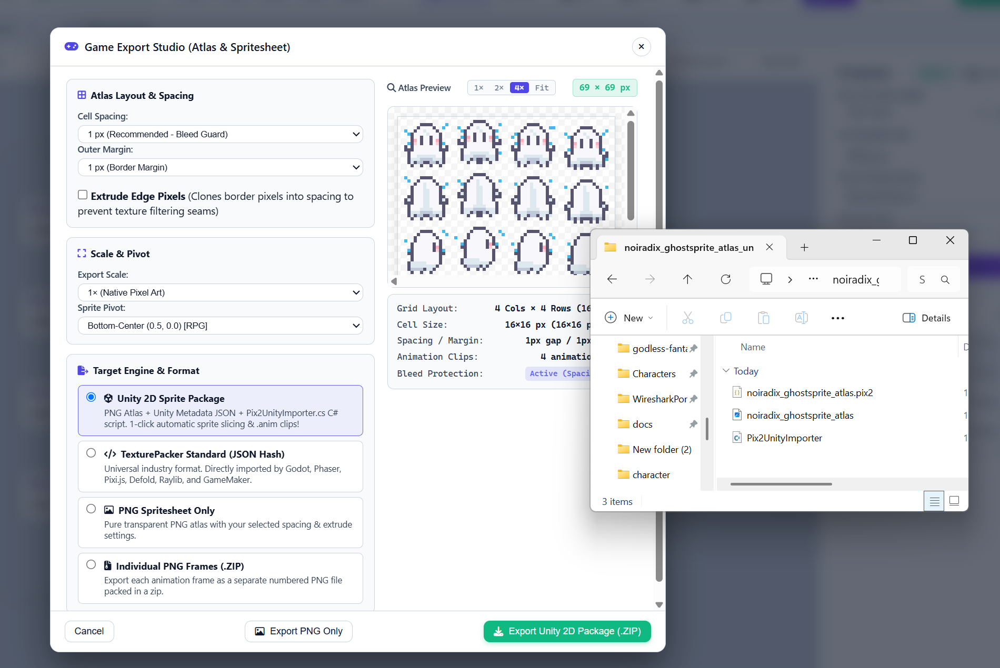
*Configuring sprite sheet padding, extrude edge guards, and Unity metadata in NOIRADIX Studio.*

---

### Step 2: Download & Inspect the Unity Package (.ZIP)
Open the downloaded `{project}_unity_package.zip` archive. It contains the sprite atlas PNG, `.pix2.json` metadata, `Pix2UnityImporter.cs`, and `README_UNITY_IMPORT.txt`.

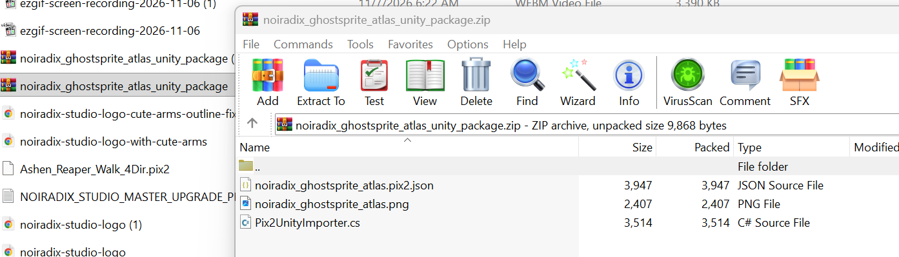
*Package contents: atlas texture, metadata JSON, 1-click C# importer script, and instruction guide.*

---

### Step 3: Drag Sprites & Metadata into Unity
Drag the sprite atlas PNG and `.pix2.json` metadata file directly into your Unity project directory (e.g. `Assets/_Game/Art/Sprites/Noiradix/`). Make sure `Pix2UnityImporter.cs` is inside your project's `Editor/` folder (`Assets/_Game/Editor/`).

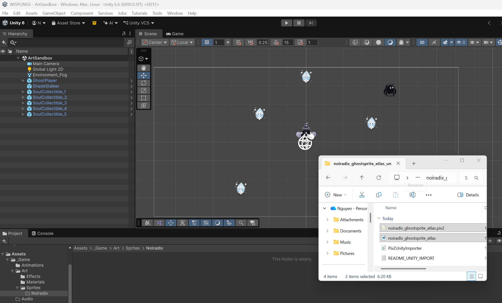
*Dragging the exported atlas and JSON metadata from File Explorer into Unity's Project tab.*

---

### Step 4: Files Placed in Unity Project Tab
Both the transparent atlas PNG and `.pix2.json` metadata files appear in your designated sprite directory:

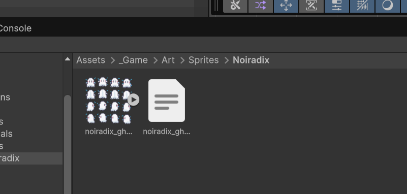
*Prismatic sprite atlas and JSON metadata ready for 1-click automatic processing.*

---

### Step 5: 1-Click Right-Click Context Menu Import
In your Unity Project window, **RIGHT-CLICK** the `.pix2.json` file and select:  
👉 **NOIRADIX > Import Spritesheet & Animations**  
*(Or use the top menu bar: `Tools > NOIRADIX > Import Pix2 Spritesheet JSON...`)*.

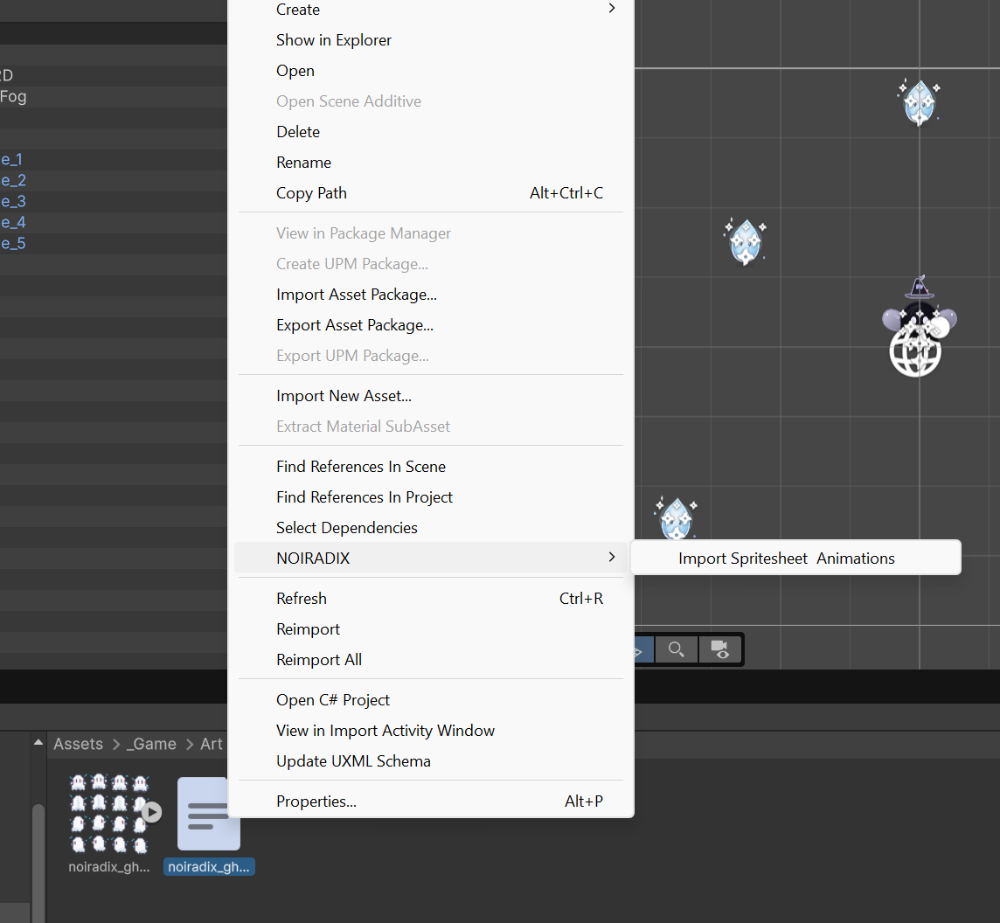
*Executing the 1-click automated asset processing pipeline.*

---

### Step 6: Import Complete Confirmation
An import summary dialog confirms that all 16 frames were sliced and 4 native `.anim` Animation Clips were generated:

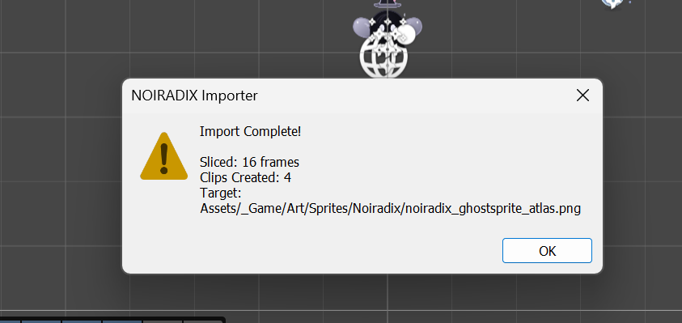
*Confirmation dialog displaying sliced frame count, animation clips generated, and target file path.*

---

### Step 7: Automatic `Animations/` Folder Creation
The importer automatically creates an `Animations/` subfolder right beside your sprite containing all 4 directional Animation Clips:

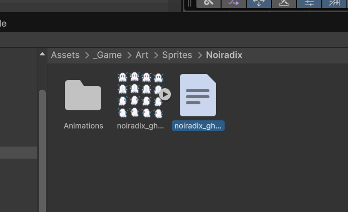
*The `Animations` directory is automatically generated containing `walk_down`, `walk_left`, `walk_right`, and `walk_up`.*

---

### Step 8: Native Animation Timeline & Keyframe Verification
Open the native Unity Animation window on `walk_down` to see all 4 keyframes pre-wired with 6 FPS timing, loop settings, and sprite curve bindings:

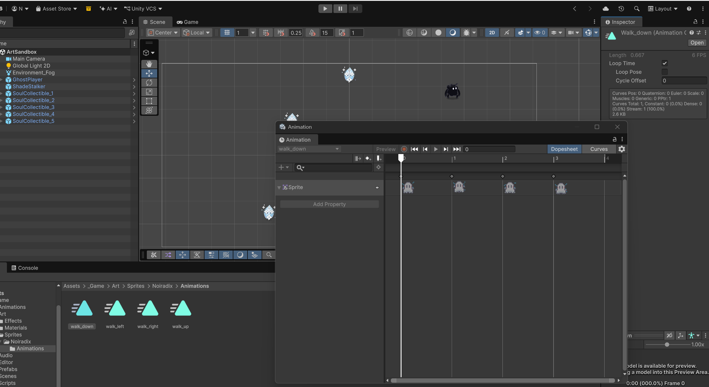
*Native Unity Animation Dopesheet timeline with 4 keyframes bound to SpriteRenderer.m_Sprite.*

---

### Step 9: Sliced Sub-Sprites & Dragging into Scene
Click the expand arrow next to the sprite atlas to view all 16 sliced sub-sprites (`Noiradix Down 0`, `Noiradix Down 1`, etc.). Drag `Noiradix Down 0` directly into your Scene:

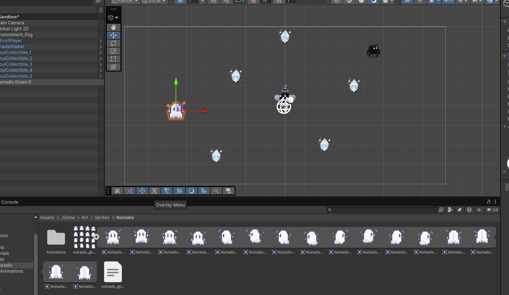
*All 16 sliced sub-sprites visible in the Project tab and placed directly into the Scene viewport.*

---

### Step 10: Live Animator Controller & Scene Setup
Attach the animation clip to the sprite to automatically create an Animator Controller component in your scene:

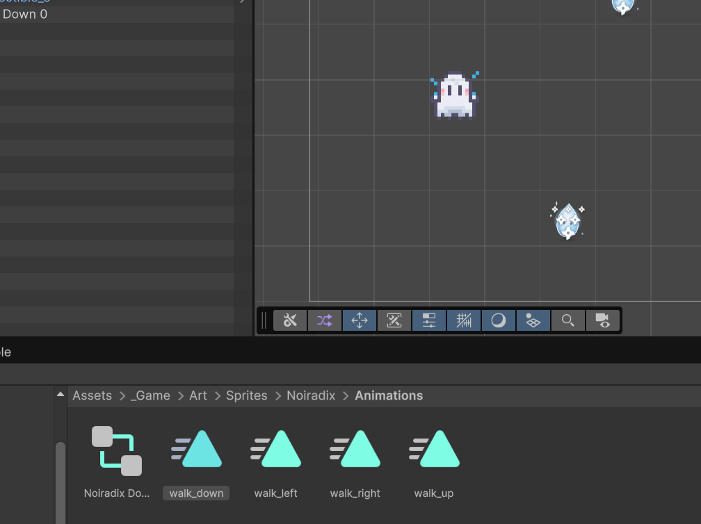
*Character positioned in the scene alongside the generated Animator Controller.*

---

### Step 11: Live Walking Animation in Scene (Real-Time Playback)
Press **Play Game** and watch your character animate with crisp point filtering and zero texture bleeding seams!

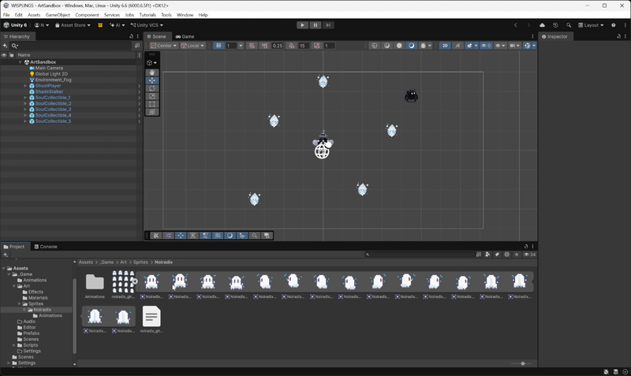
*Real-time animated walk cycle running smoothly inside Unity 6.*


*Crisp point-filtered sprite rendering aligned with scene lights and colliders.*

---

## 🗺️ Documentation Sitemap & Master Index

The documentation suite is structured into focused domains covering every aspect of the project:

```
docs/
├── README.md                          # Master documentation portal (This file)
├── PRODUCT_SPEC.md                    # Core product requirements, boundaries, and principles
├── UX_AND_INTERACTION_SPEC.md         # UI/UX interaction standards, modal behavior, tabs
├── KEYBOARD_SHORTCUTS.md              # Complete cross-platform keyboard shortcuts matrix
├── FILE_LIFECYCLE_SPEC.md             # File handling, File System Access API, and drafts
├── FILE_LIFECYCLE_AND_AUTOSAVE.md     # In-depth file persistence, draft isolation, and recovery
├── HISTORY_AUTOSAVE_RECOVERY_SPEC.md  # Undo/Redo stack, snapshot compression, dirty tracking
├── ZOOM_RULER_AND_INTERACTION.md      # Canvas viewport math, dynamic rulers, anchor zoom
├── SELECTION_AND_CONTEXT_MENU.md      # Marquee selection, floating clipboard, context menus
├── ARCHITECTURE.md                    # High-level architecture and subsystem relationships
├── ROADMAP_AND_ISSUES.md              # Milestone tracking, resolved bugs, and future backlog
│
├── PIX2/                              # Formal .pix2 language and AI authoring specifications
│   ├── PIX2_SPEC.md                   # Core format specification, blocks, and directives
│   ├── PIX2_GRAMMAR.md                # Formal EBNF grammar, lexer rules, and token definitions
│   ├── PIX2_DATA_MODEL.md             # In-memory JavaScript data models and schemas
│   ├── PIX2_AI_AUTHORING_GUIDE.md     # Prompt engineering templates and one-shot recipes for LLMs
│   ├── PIX2_VALIDATION_RULES.md       # Validation criteria, boundary limits, and error diagnostics
│   ├── PIX2_COMPATIBILITY.md          # Version transitions and cross-tool interoperability
│   └── PIX2_EXAMPLES.md               # Machine-verifiable canonical .pix2 document examples
│
├── FEATURES/                          # Deep-dive engineering specifications
│   ├── GRID_AND_CELL_MODEL.md         # Grid lookup, decoupled IDs, row duplication, and flip
│   ├── ANIMATION_MODEL.md             # Directional clips, timeline player, and FPS timing
│   ├── PALETTE_AND_AUTO_GENERATION.md # Palette extraction, color quantization, and remapping
│   ├── SELECTION_AND_CONTEXT_MENUS.md # Floating selection transforms and clipboard buffer
│   ├── ZOOM_RULERS_COORDINATES.md     # Pixel rulers, coordinate tracking, and viewport transforms
│   └── LAYERS_PIVOT_HITBOX_FUTURE.md  # Forward specifications for layers, pivots, and hitboxes
│
├── ENGINEERING/                       # Systems engineering, test plans, and limits
│   ├── ARCHITECTURE.md                # System module boundaries and dependency policies
│   ├── TEST_PLAN.md                   # Automated roundtrip and security test suite matrix
│   ├── IMPLEMENTATION_ROADMAP.md      # Milestone completion report and architectural phases
│   └── KNOWN_LIMITATIONS.md           # Documented platform boundaries and browser security limits
│
└── audits/                            # Quality audits and verification logs
    ├── BASELINE_AUDIT.md              # Baseline codebase audit and gap analysis
    ├── IMPLEMENTATION_REPORT.md       # Implementation audit of the master refactor
    └── SYSTEM_AUDIT_REPORT.md         # Comprehensive health and security verification report
```

---

## 🏗️ System Architecture & Dataflow

The diagram below illustrates the end-to-end flow of pixel data across human inputs, AI assistants, the local filesystem, and game engine export targets:

```mermaid
flowchart TD
    subgraph InputSources["Input & Authoring Sources"]
        HumanArtist["Human Artist\n(Mouse, Tablet, Keyboard)"]
        AIAssistant["AI Coding Assistant\n(ChatGPT, Claude, Gemini, Antigravity)"]
        DiskFile["Local Disk File\n(*.pix2)"]
    end

    subgraph CoreEngine["NOIRADIX Studio Core Engine (Vanilla JS)"]
        ParserSerializer["PIX2 Parser & Serializer\n(pix2-format.js)"]
        EditorState["State & Undo Store\n(editor-state.js)"]
        CanvasRenderer["Canvas 2D Viewport\n(Pixel Grid, Rulers, Symmetry)"]
        AnimStudio["Animation Studio\n(animation-player.js)"]
        DiskWatcher["Live File Watcher &\nHandle Store (IndexedDB)"]
    end

    subgraph ExportPipelines["Production Game Export Studio"]
        UnityExport["Unity 2D Package (.ZIP)\nAtlas PNG + Metadata JSON + Pix2UnityImporter.cs"]
        TexturePacker["TexturePacker Standard JSON (.ZIP)\nGodot 4, Phaser, Defold, Raylib"]
        SlicedPNG["Sliced Frames (.ZIP) / PNG Atlas\n(Anti-Bleeding Padding + Extrude Guard)"]
    end

    HumanArtist --> CanvasRenderer
    AIAssistant -->|Structured Text| DiskFile
    DiskFile -->|Read / Live Reload| DiskWatcher
    DiskWatcher --> ParserSerializer
    ParserSerializer --> EditorState
    EditorState --> CanvasRenderer
    EditorState --> AnimStudio
    CanvasRenderer -->|Ctrl+S Direct Commit| DiskWatcher
    DiskWatcher -->|createWritable()| DiskFile

    EditorState --> ExportPipelines
```

---

## 🎯 Role-Based Reading Guides

### 🎨 For Pixel Artists & Game Designers
* **[Quick Start Guide](../README.md#🚀-quick-start-guide-5-minutes):** Fast-track guide to launch and begin painting.
* **[Precision Pixel Editor Guide](ZOOM_RULER_AND_INTERACTION.md):** Learn how to use the bilateral symmetry axis (`sym_dot`), pixel rulers, anchor zoom, and discrete drawing tools.
* **[Animation & Locomotion Workflow](FEATURES/ANIMATION_MODEL.md):** Set up 4-direction and 8-direction character walk cycles, adjust frame timing, and test playback.
* **[Palette Tools & Extraction](FEATURES/PALETTE_AND_AUTO_GENERATION.md):** Auto-extract palettes from imported artwork and manage swatches without destructive recoloring.
* **[Keyboard Shortcuts Matrix](KEYBOARD_SHORTCUTS.md):** Boost your drawing speed with single-key shortcuts including Pencil (<kbd>B</kbd>), Hand/Pan (<kbd>H</kbd>), Symmetry (<kbd>S</kbd>), and Viewport reset (<kbd>Ctrl+0</kbd>).

---

### 🤖 For AI Engineers & LLM Prompt Authors
* **[AI Mascot Case Study (Gemini 3.8 Flash)](PIX2/PIX2_AI_AUTHORING_GUIDE.md#8-real-world-case-study-creating-noiradix_ghostpix2-with-gemini-38-flash):** Complete breakdown of how Gemini 3.8 Flash authored the official 4-directional 16-frame Noiradix Ghost template.
* **[PIX2 Language Specification](PIX2/PIX2_SPEC.md):** Complete definition of `@meta`, `@grid`, `@palette`, `@cell`, and `@animation` directives.
* **[AI Authoring Guide & One-Shot Prompts](PIX2/PIX2_AI_AUTHORING_GUIDE.md):** Master prompt template, system instructions, and walk-cycle mathematics for ChatGPT, Claude, and Gemini.
* **[Formal EBNF Grammar](PIX2/PIX2_GRAMMAR.md):** Unambiguous grammar specification for building external parsers and language servers.
* **[Validation Criteria & Diagnostics](PIX2/PIX2_VALIDATION_RULES.md):** Strict boundary checks and error codes to ensure generated sprites are 100% valid.
* **[Machine-Verifiable Examples](PIX2/PIX2_EXAMPLES.md):** Canonical samples covering static props, 4-directional walk strips, and 8-directional combat sprites.
* **[Future Directions & Coordinate-Aware Raster Editing](PIX2/PIX2_FUTURE_DIRECTIONS.md):** Exploratory research proposal for extending PIX2 principles to high-resolution raster workflows (ROI selection, local PIX2 Patch, and deterministic coordinate editing).

---

### 🎮 For Game Engine Programmers (Unity, Godot, Phaser)
* **[Unity 2D Spritesheet Package Integration](../README.md#unity-2d-top-down--platformer):** How the included C# `Pix2UnityImporter.cs` automatically slices frames, sets pixel-perfect texture settings, and generates native `.anim` AnimationClips.
* **[Anti-Bleeding & Sub-Pixel Filtering Protection](PRODUCT_SPEC.md):** Understanding Cell Spacing (`0px`–`4px`) and Extrude Edge Pixels to prevent GPU seams in camera-zoomed scenes.
* **[Pivot Point Presets](PRODUCT_SPEC.md):** Standardizing pivot points for 2D top-down RPG characters (`Bottom-Center: 0.5, 0.0`) vs center-rotated props (`0.5, 0.5`).
* **[TexturePacker Format Specification](PIX2/PIX2_COMPATIBILITY.md):** Integrating exported JSON Hash atlases into Godot 4 `AnimatedSprite2D`, Phaser, and WebGL.

---

### 💻 For Core Engine Contributors & Maintainers
* **[System Architecture & Invariants](ENGINEERING/ARCHITECTURE.md):** Read before writing code. Enforces the strict **Zero-Runtime-Dependency** and **Pure Vanilla Web Stack** rules.
* **[File Lifecycle & Draft Separation](FILE_LIFECYCLE_SPEC.md):** How the Chromium File System Access API, IndexedDB caching, and in-memory draft sessions prevent data loss.
* **[Test Plan & Verification Matrix](ENGINEERING/TEST_PLAN.md):** How to run the automated test suite (`96` roundtrip tests + `14` security defense tests).
* **[Known Platform Limitations](ENGINEERING/KNOWN_LIMITATIONS.md):** Documented boundaries around browser sandbox security, memory caps, and cross-browser fallbacks.

---

## 🧪 Automated Testing & Verification

NOIRADIX Studio maintains a comprehensive test suite executed directly via Node.js with zero test framework dependencies:

```bash
# 1. Run semantic parse-serialize roundtrip tests (96/96 Passing)
node tests/test-roundtrip.js

# 2. Run security, prototype-pollution & anti-DoS defense tests (14/14 Passing)
node tests/test-security.js

# 3. Verify JavaScript syntax integrity
node --check js/app.js
node --check js/pix2-format.js
node --check js/editor-state.js
node --check js/animation-player.js
node --check js/tools.js
```

---

## 🏛️ Guiding Core Invariants

All development in NOIRADIX Studio adheres to three non-negotiable principles:

1. **Zero Runtime Dependencies:** No npm runtime packages, no frameworks (React, Vue, etc.), no build tools (Webpack, Vite). The application must remain executable simply by double-clicking `index.html`.
2. **100% Offline-First:** Zero telemetry, zero external network requests. All drawing, animation, storage, and exports execute completely locally in the user's browser.
3. **Lossless Artwork Preservation:** Grid expansions, directional conversions, row movements, and format updates must **never** erase or destructively overwrite existing drawn pixels.
